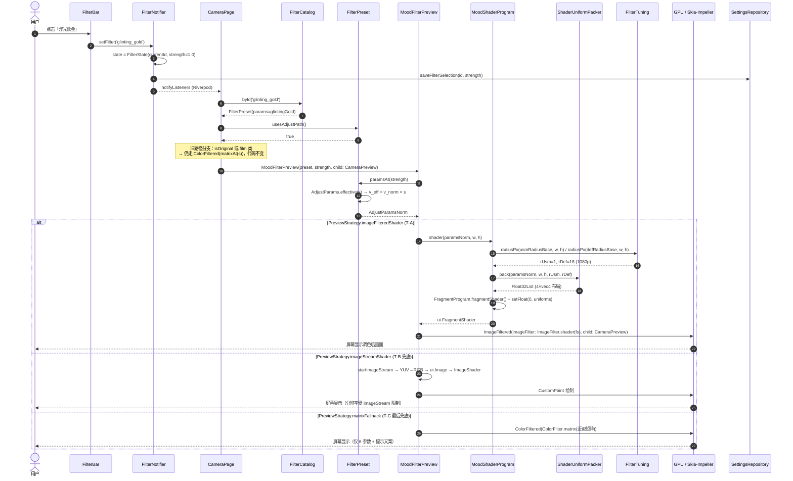
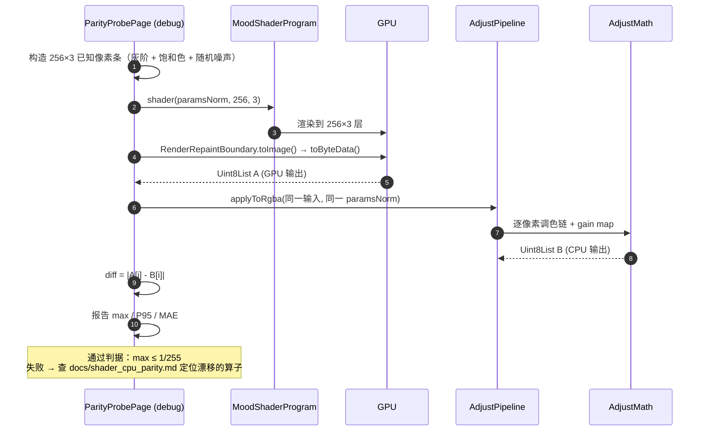
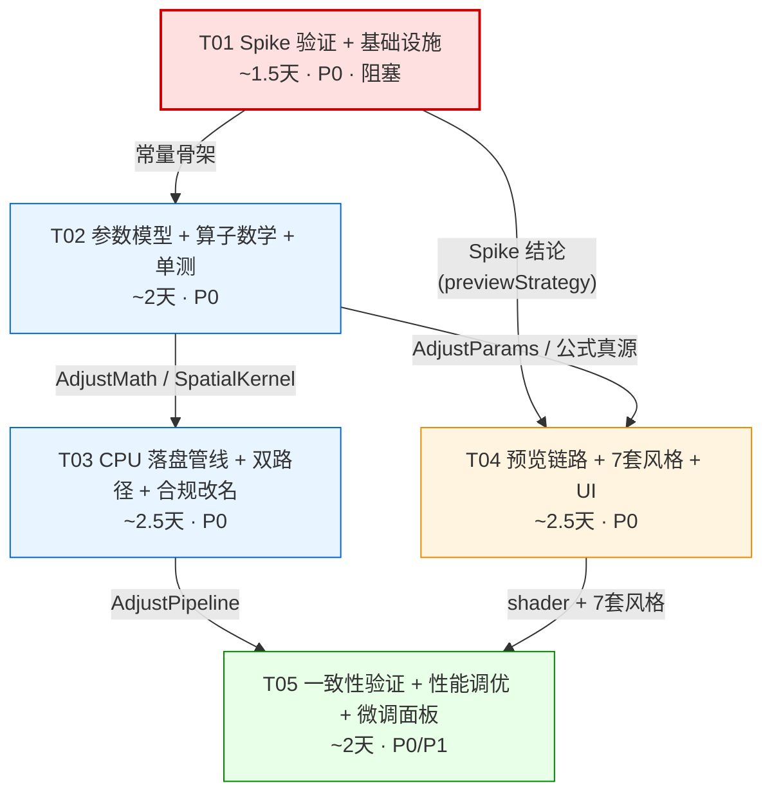

# DokaLike Camera — 滤镜引擎升级架构设计

| 项 | 内容 |
|---|---|
| 文档类型 | 引擎级改造架构设计 + 任务分解 |
| 项目 | `C:/Users/Administrator/WorkBuddy/2026-09-28-15-36-25/dokalike_camera` |
| 技术栈 | Flutter 3.24 / Dart 3.5 · iOS(Impeller) + Android(Skia) · 56 个 Dart 文件 |
| 提出人 | 高见远（Gao）· 架构师 |
| 上游输入 | `deliverables/filters-incremental-PRD.md`（许清楚 · PM，533 行） |
| 下游 | 工程师实现 / QA 一致性验收 |
| 本机状态 | ⚠️ **无 Flutter/Dart SDK，本文所有结论均未经过编译或真机验证**；涉及运行时行为的部分一律标注为「待 Spike 验证」（见 §2 与 T01） |

---

## 0. 摘要：五个核心问题的结论（先看这里）

| # | 问题 | 我的结论 | 置信度 |
|---|---|---|---|
| **1** | 预览/落盘一致性 | **方案 A+：单一公式真源 + 双后端实现（GPU shader 预览 / CPU Dart 落盘）+ 空间算子统一在「标准尺度」上计算 + 三档一致性验证**。明确**否决**「落盘也走 GPU」。**v2 修订**：采纳 PM §5.2，清晰度与锐度**不再**做分辨率近似，改为两端都在标准尺度（长边 1080）计算 → **一致性由构造保证，不是靠容差兜** | 高 |
| **2** | Spike 验证 | **阻塞项，必须第一步做**。我已识别出 **3 条互斥的技术路线**（T-A `ImageFiltered`+`ImageFilter.shader` / T-B `startImageStream`+`ui.Image`+`ImageShader` / T-C 参数降级），并给出 12 条判定标准。Spike 未出结论前**不得启动 T04** | — |
| **3** | 双路径共存 | **`FilterPreset` 加一个可选的 `AdjustParams` 字段**，`usesAdjustPath` 派生；落盘/预览各加一层分派。旧路径**零改动**（不碰 `ColorMatrixKit`、不碰 `matrixAt`） | 高 |
| **4** | 性能预算 | **v2 修订（PM 拍板）**：接受「自适应**并行度**」，**否决**「自适应算子近似」（同一张照片在不同手机上出片不同，产品上不可接受）。改为 **选项④（PM 推荐、我同意）**：空间算子标准尺度 + 自适应并行度 → 预计 **≤1.5s 且一致性按构造保证**。3s 是兜底不是默认 | 中（估算值，需实测） |
| **5** | 其他约束 | 曝光在 linear 域 ✅；LUT 废弃 ✅；强度 `v_eff=v_norm×s` ✅；**混合域采纳**（PM 已拍板）→ 新增「算子顺序不可交换，须两端同序」硬要求。**⚠️ 合规冲突已确认（权威基线 35 处 / 8 文件）**，PM 已拍板 A 方案；三方互补后发现 6 类问题：验收 grep 命令有 bug、合规自检测试自身含商标、**camelCase 变量名易漏改**、黑名单误含自有品牌 Doka、**守卫从未检查 id 列**、CJK 需子串语义 → 见 §9-2 | — |

---

## 1. 方案选型（逐条对比 + 推荐 + 理由 + 风险）

### 1.1 【头号难题】预览 / 落盘一致性

#### 1.1.1 候选方案

| 方案 | 描述 | 优点 | 缺点 |
|---|---|---|---|
| **A. 双实现同公式 + 容差验收** | 预览 GLSL，落盘 Dart，两套代码翻译同一份数学公式，靠 §9 容差兜住 | 落盘确定性、可在 CI 单测；不依赖 GPU readback；保持现有「纯 Dart 引擎」架构 | 两套代码可能漂移；GPU float32 vs Dart float64；纹理采样差异；分辨率相关算子天然不同 |
| **B. 落盘也走 GPU**（离屏渲染 + readPixels） | 用 `RenderRepaintBoundary.toImage()` / 平台通道 FBO，把滤镜在 GPU 上渲染到 12MP 纹理再回读 | 理论上「完全同源」，无漂移 | ❌ Flutter 无公开的任意分辨率离屏 FBO + readPixels API；`toImage()` 受 `maxTextureSize` 限制且 12MP 回读 48MB 极慢；**结果随 GPU/驱动漂移**，无法在 CI 固化基线；破坏「纯 Dart 可单测」；耗时不可控 |
| **C. 预览也走 CPU** | 降采样预览流 → Dart 逐像素 → 显示 | 完全同源 | ❌ 数学上不可能：640×480 每像素约 200 flops → 61 Mflop/帧 → 单线程 0.2–0.6s/帧，即使 8 核并行 320×240 也只有 ~20fps 且画质极差 |
| **D. A 的强化版（我推荐）** | A + 四条工程化约束 | 见下 | 见下 |

#### 1.1.2 推荐：**方案 D（A 的强化版）**

在「两套代码、同一套公式、靠容差验收」的基础上，追加四条硬约束，把残差压到可控：

**约束 D-1′（v2 修订，采纳 PM §5.2）：空间算子统一在「标准尺度」上计算 —— 一致性由构造保证，而非靠容差兜**

> **这是 PM 的 §5.2 提案，我评估后认为它严格优于 v1 的 D-1，全盘采纳。**

定义**标准尺度（Standard Scale）**：`standardScaleLongEdge = 1080`。所有空间算子（锐度 USM、清晰度 Definition）**一律在「长边 = 1080 的降采样图上」计算**，两端都用**完全相同**的整数半径 `rBase`：

```
① 把【原始输入亮度 L_src】降采样到长边 = 1080（box 平均）
② 在该图上用整数半径 rBase 计算 gain map      ← 预览与落盘这一步逐像素等价
③ 把 gain map 双线性上采样回目标分辨率，乘到已调色的 RGB 上
```

| 端 | 步骤① | 步骤② | 步骤③ |
|---|---|---|---|
| **预览**（shader 单 pass） | 输入纹理本身就是长边 ≈1080 的尺度 | `rBase`（整数，逐像素采样） | 无需上采样，直接输出 |
| **落盘**（CPU 12MP） | 12MP 亮度 → 降到 1080×810 | **同一个 `rBase`、同一套采样点** | gain 上采样回 12MP |

**为什么这比 v1 的 D-1 好：**

| | v1 D-1（半径按短边归一化 + 落盘侧降分辨率近似） | **v2 D-1′（标准尺度）** |
|---|---|---|
| 一致性来源 | 归一化后**近似**匹配，残差靠容差兜 | **按构造一致** —— 两端执行的是同一段代码语义、同一个整数半径、同一套采样点 |
| 设备一致性 | v1 的 `definitionCpuDownscale` 随核数变化 → 同图不同机出片不同（PM 明确否决） | 标准尺度是**常量**，与设备无关 ✅ |
| 落盘成本 | Definition 全分辨率 1.5–2.0s / 半分辨率 ~0.1s 但引入近似 | 1080×810 × 16 taps ≈ **0.05s**，且无近似 |
| 取整误差 | `round(rBase × min(w,h)/1080)` 两端取整后比值偏离 | 两端都用**未取整的 `rBase`**，取整误差不存在 |

**关键洞察**：v1 里我试图让「12MP 的 45px 半径」去匹配「1080p 的 16px 半径」，本质上是在让两个不同分辨率的算子互相逼近 —— 无论怎么归一化都是近似。v2 直接把**两端拉到同一个分辨率**再算，问题消失了。

**⚠️ 关于「12MP 锐化是上采样得到的，会不会偏软」—— 这不是缺陷，是定义**（PM 纠正了我的定性，我接受）：

> 本项目的「所见即所得」基准就是 **成片 = 预览**，而预览本身就工作在标准尺度。所以标准尺度下的观感**就是基准观感**，不存在另一个 ground truth。所谓「偏软」是拿一个并不存在的「原生 12MP USM」当参照系得出的伪结论。

配套一条**实证要求**（不是因为怀疑它是缺陷，而是用户主观接受度需要被验证一次）：P1 阶段用 9.1-A 的 A/B 图确认在最大锐度（`锐度 +16`，丁达尔风格）下无可察觉劣化。

**约束 D-5（v2 新增，关键易错点）：shader 必须被告知「图像的实际渲染长边」，而不是图层尺寸**

`CameraPreview` 在实际 UI 里是 **scale-to-cover + ClipRect**（`camera_page.dart` 现有实现），屏幕是竖屏而图像是 4:3，因此**图层尺寸 ≠ 图像渲染尺寸**。若 shader 直接拿 `uTexSize`（图层，如 1080×2400）去换算半径，会得到错误的作用尺度。

* `MoodFilterPreview` 必须把**图像的 contain/cover 后实际渲染长边（像素）**作为 uniform 传给 shader；
* 落盘侧同样以**照片长边**为基准做降采样（`standardScaleLongEdge = 1080`）；
* 9.1-A 的一致性比对入口（§3.5 的 `consistency_harness_page.dart`）必须**去掉裁剪、按 contain 完整渲染、并固定长边 = 1080**，否则两端尺度不同、比对无意义。

**约束 D-2：空间算子与调色解耦 —— gainMap 只从「原始输入亮度」计算**

```
gain_sharp / gain_def 的输入 = 输入图的亮度 L_src（未经任何调色）
最终 RGB = RGB_toned × gain_sharp × gain_def
```

* 为什么必须这样：Flutter `FragmentProgram` 是**单 pass**，没有 FBO / 多 pass / render-to-texture。若空间算子要作用于「调色后的亮度」，shader 必须对每一个邻域 tap 重跑一遍完整的调色链（25 taps × ~30 flops = 750 flops/px，1080p @30fps = 45 Gflop/s，中低端机必掉帧）。
* 解耦后：本像素跑一次调色（~60 flops）+ 邻域只需采样原始亮度（~34 taps × 5 flops）= **约 230 flops/px**，1080p @30fps ≈ 14 Gflop/s，安全。
* 视觉代价：tone curve 是单调映射，边缘方向与相对对比关系不变，USM/Definition 观感差异可忽略。
* **收益**：CPU 侧用**完全相同**的解耦结构 → 一致性天然成立。

**约束 D-3：采样点必须「整数偏移 + 精确对齐 texel 中心」**

* GLSL 侧：`uv = (vec2(x, y) + 0.5) / uTexSize`，其中 `(x, y)` 为整数像素坐标。当采样点精确落在 texel 中心时，bilinear 退化为最近邻（权重 1/0），与 CPU 的整数索引**数学等价**。
* CPU 侧：同一套整数偏移，直接索引 `Uint8List`。
* ❌ 禁止在两端使用**不同的**采样策略（如 GLSL 用 bilinear 模糊坐标、CPU 用整数索引）——这是最容易埋下的不一致雷。
* ⚠️ 残余风险：GPU bilinear 在 texel 中心处的定点插值精度。<u>由 Spike 的 S-7 探针专门验证</u>。

**约束 D-4：sRGB ↔ linear 必须用「精确分段公式」，禁止 `pow(x, 2.2)` 近似**

* IEC 61966-2-1 分段公式 vs `pow(x,2.2)` 在中低亮度处最大偏差可达 **2–3 / 255**，会直接吃掉 MAE ≤6 预算的三分之一以上。
* 实现：两端各用一张 **256 项 `Float32List` 查表**（CPU 启动时构建；GLSL 侧用同一公式直接计算，或编译时烘焙为常量数组——见 §7 共享知识 #C）。
* 查表 vs 直接算的残差 < 1e-7，可忽略。

#### 1.1.3 一致性验证的三档机制（方案 D 的验收手段）

| 档 | 名称 | 场合 | 判据 | 谁做 |
|---|---|---|---|---|
| **L1** | **数值对拍（Parity Probe）** | 真机 debug 页，随 Spike 一起做 | 256×3 已知像素条 → shader 渲染回读 vs Dart 参考实现，**逐像素 \|Δ\| ≤ 1/255** | 工程师（T01 搭骨架，T05 补全） |
| **L2** | **引擎级单测（CI）** | `flutter test` | 恒等性（s=0 逐像素误差 = 0）、单调性、边界钳制、参数独立性 | 工程师 + QA |
| **L3** | **端到端（真机 84 组）** | 按 PRD §9.1/§9.2 | MAE ≤6 / P95 ≤12 / Pmax ≤25 / ΔE*ab ≤5 | QA |

> **L1 是本方案的关键创新点**：它把「GPU 数学是否等于 CPU 数学」这个命题，从「拍 84 组照片靠人眼」变成「一个 debug 页面的自动断言」，且**在 Spike 阶段就能跑**，不必等 7 套风格全部落地。没有 L1，方案 D 就是盲飞。

#### 1.1.4 风险

| 风险 | 等级 | 缓解 |
|---|---|---|
| GLSL 与 Dart 代码漂移 | 高 | 强制维护 `docs/shader_cpu_parity.md` 逐行对照表；所有算子写在 `AdjustMath` 的纯函数中，GLSL 按其逐行翻译；L1 探针自动化 |
| **算子顺序漂移**（v2 新增，PM §5.1） | **高** | 混合域下算子**不可交换**。§7 #B 的 15 步顺序是唯一定义，两端逐算子同序；L1 探针增加**变异测试**：故意颠倒一步顺序的变体必须**断言失败**，证明探针对该风险敏感 |
| ~~清晰度 CPU 降分辨率近似~~（v1 的头号风险） | ✅ **已消解** | v2 标准尺度方案下不再存在近似，一致性按构造保证 |
| **标准尺度下 gain 上采样的残差**（v2 新增） | 中 | gain 场本身是低频平滑量，12MP 上采样后再降采样回 1080 ≈ 原 gain；由 L1/L3 实测确认 |
| **图层尺寸 ≠ 图像渲染尺寸**（v2 新增，D-5） | 中 | `MoodFilterPreview` 显式传图像渲染长边；harness 固定长边 1080 且去裁剪；Spike 增加对该 uniform 的验证 |
| 预览输入（相机实时流）与成片输入（JPEG 解码）本身不同 | 中 | 非引擎可消除项。PM 已改为 §9.1 两级：A 静态图同路径比对（P0 通过条件）/ B 真实拍摄（放宽、仅留档） |
| GPU 精度 / 纹理过滤差异 | 中 | D-3 + Spike S-7 |
| 自动曝光/白平衡在快门瞬间的变化 | 低 | 归入 §9.1-B，不设 P0 通过条件 |

---

### 1.2 【阻塞项】预览 shader 技术路线 Spike

#### 1.2.1 我识别出的 3 条技术路线（PRD §10-R2 未覆盖的关键事实）

> ❗ **PRD 与现有代码都没有意识到的一个硬事实**：`CameraPreview` 是 **平台外部纹理**（`Texture(textureId:)`），**无法直接作为 `ui.Image` 传给 `FragmentProgram` 的 sampler**。所以「写个 shader 包住相机预览」这句话本身就有三条互斥的实现路径，可行性差别巨大。

| 路线 | 机制 | 可行性预判 | 画质 | 性能 | 兼容性 |
|---|---|---|---|---|---|
| **T-A** `ImageFiltered` + `ui.ImageFilter.shader` | `ImageFiltered(imageFilter: ImageFilter.shader(fs), child: CameraPreview(...))`。Flutter 把 child 绘制到离屏层，再用 shader 处理 | **待验证** | ✅ 屏幕分辨率，最清晰 | ✅ 单个 GPU pass，无 CPU 开销 | ⚠️ `ImageFilter.shader` 为 3.19+ API；iOS 走 **Impeller**、Android 走 **Skia**，两端后端不同，需分别验证 |
| **T-B** `startImageStream` + `ui.Image` + `ImageShader` | 插件回调 `CameraImage` → Dart 做 YUV/NV21→RGB → `ui.decodeImageFromPixels` → `CustomPainter` 用 `ImageShader` 绘制 | **待验证**（原理上确定可行） | ❌ 受 imageStream 分辨率限制（通常 720p 甚至更低），全屏拉伸会糊 | ⚠️ 每帧 CPU 转码 720p ≈ 3–8ms + GPU 上传，边缘可达 30fps | ✅ 只依赖 `FragmentProgram`（3.7+ 全后端稳定） |
| **T-C** 参数降级 | 退回 `ColorFiltered` 矩阵，只做 6 参数，高光/阴影用分段线性近似 | 确定可行 | ✅ | ✅ | ✅ |

**我的排序与推荐：**

1. **首选 T-A**。它是唯一能同时满足「全屏清晰 + 30fps + 全 11 参数（含空间算子）」的路径。
2. **兜底 T-B**（若 T-A 在任一端不可用）。代价是预览清晰度下降；但**仍满足 P0-2「肉眼可见生效」与「≥30fps」**，且不牺牲参数完整性。
3. **最后兜底 T-C**（PM 已明确不推荐，我同意；仅当 T-A/T-B 双双不可用时启用）。若被迫启用，我建议的降级形态是：**保留 11 参数的落盘实现 + 预览只做其中矩阵可表达的 6 参数，并在预览上叠加一条「预览为近似，成片更丰富」的提示**——而不是删除参数能力。

> **架构上的隔离设计**：`MoodFilterPreview` 用策略模式封装 T-A / T-B / T-C，`PreviewStrategy` 由一个 `AppConstants.previewStrategy` 常量切换。**Spike 结论只影响这一个常量的默认值，不影响任何其他代码**。

#### 1.2.2 Spike 验证清单（12 条，交给工程师在真机执行）

| 编号 | 验证项 | 方法 | 通过判据 |
|---|---|---|---|
| **S-1** | `FragmentProgram.fromAsset` 在 **Android（Skia/GLES）** 能否加载并编译 | 最小 shader（纯 passthrough） | 无异常，画面正常 |
| **S-2** | 同上，**iOS（Impeller/Metal）** | 同上 | 同上 |
| **S-3** | **T-A 路线可用性**：`ImageFiltered` + `ImageFilter.shader` 包裹 `CameraPreview` | 最小 shader 原样输出 | 画面正常显示，无黑屏/崩溃 |
| **S-4** | shader 中输入纹理的 **uniform 名称与绑定方式** | 试 `uTexture` / `uInput` / sampler 0 自动绑定 | 确定可工作的写法（写进共享知识） |
| **S-5** | 能否拿到**输入纹理尺寸**（`uSize` 手动传 / `textureSize()` 内建） | 试两种 | 确定像素坐标与 UV 的正确换算 |
| **S-6** | `FlutterFragCoord()` 与纹理坐标的**原点方向**（左上 vs 左下，是否 Y 翻转） | 渲染一个上红下蓝的图，看输出 | 确定坐标系（决定 CPU 侧行序） |
| **S-7** | **采样一致性探针**：整数偏移 + texel 中心对齐的 `texture()` 是否严格等于最近邻 | 用 256×1 已知条纹纹理，shader 输出 `texture()` 值 → 回读 → 与已知值比对 | **逐元素误差 = 0**（若 >0，改用 `texelFetch` 或记录偏差量） |
| **S-8** | **多 uniform 支持**：`uniform vec4` 数组式打包（4×vec4 装 11 参数） | 传参并渲染 | 参数正确生效 |
| **S-9** | **帧率实测**：全 11 参数 shader（含 9 taps USM + 16 taps Definition）在 1080p 下的稳定帧率 | `SchedulerBinding.addTimingsCallback` 或 Flutter DevTools，连续 10s | **≥30fps（P50）**；记录 P5/P50/P95 |
| **S-10** | **低端机帧率**（准备一台千元级 Android） | 同上 | ≥24fps 视为可接受，否则需裁剪 taps |
| **S-11** | **T-B 路线可行性**（仅当 T-A 失败时）：`startImageStream` 回调格式、`ImageFormatGroup` 支持度、转码耗时 | 计时 | 端到端 ≤33ms/帧 |
| **S-12** | **回读通道**：`RenderRepaintBoundary.toImage()` + `toByteData()` 是否可用于 L1 探针 | 256×1 图渲染后回读 | 能拿到 RGBA 字节 |

**Spike 产出（必须写成交付物 `deliverables/spike-report-filters.md`）：**
1. T-A / T-B / T-C 的**可用性结论**（双端分别写）；
2. S-9 / S-10 的**帧率原始数据**（P5/P50/P95，含机型与系统版本）；
3. S-4 / S-5 / S-6 的**确定的写法**（后续所有 shader 代码以此为基准）；
4. 若不可用，**选型的推荐与理由**。

> ⚠️ **Spike 未完成前，禁止启动 T04（预览链路）**。T02（参数模型与算子数学）与 T03（CPU 落盘管线）**不依赖 Spike**，可以并行启动。

---

### 1.3 双路径共存

#### 1.3.1 设计原则

| 原则 | 说明 |
|---|---|
| **旧路径零改动** | `ColorMatrixKit`、`FilterPreset.matrixAt`、旧 8 款预设、`_applyFilterJob` 的矩阵逻辑**一行都不改**。新能力全部以「新增字段 + 新增分支」形式叠加 |
| **路径由数据决定，不由 if-else 散落** | `FilterPreset.usesAdjustPath` 是唯一判定入口，全项目只在 `FilterPipeline`（落盘）与 `camera_page`（预览）两处分派 |
| **id 稳定** | Hive 里存的 `filterId` 语义不变（合规改名用哈希化迁移处理，见 §9-2） |
| **可回退** | `AppConstants.moodPathEnabled` 总开关；关掉后 7 套新风格自动降级为「不可用/隐藏」，旧路径完全不受影响 |

#### 1.3.2 抽象形态

```text
FilterPreset
 ├─ matrix4x5          （旧路径数据，必填，保留）
 ├─ params: AdjustParams?   （新路径数据，可选）
 ├─ usesAdjustPath  =>  params != null
 ├─ matrixAt(s)          （旧：恒等↔矩阵 lerp）
 └─ paramsAt(s)          （新：AdjustParams.effective(s)）
```

**为什么不让两条路径共用一个 `apply(Rgba)` 接口？**
因为预览端给的是「GPU 纹理 + Widget」，落盘端给的是「JPEG 字节 + Isolate」，两者的输入形态完全不同，强行统一会得到一个人造的、`Widget` 与 `Uint8List` 互相污染的抽象。**正确的做法是统一「参数与公式」，而不是统一「执行入口」**：

* 参数真源：`AdjustParams` / `AdjustParamsNorm`
* 公式真源：`AdjustMath`（纯函数，被 CPU 管线调用；GLSL 是它的逐行翻译）
* 执行入口：预览 `MoodFilterPreview`（Widget）/ 落盘 `AdjustPipeline`（字节）——**各自独立，只共享上面两个真源**

#### 1.3.3 风险

| 风险 | 缓解 |
|---|---|
| `FilterPreset` 变成"两种形态的联合"，语义变模糊 | 加 `assert`：若 `params != null` 则 `matrix4x5` 必须为恒等（避免两条路径同时生效）；文档约定「新风格 matrix 恒为 identity」 |
| 滤镜栏 / 推荐器对两条路径的处理分叉 | 两者都只依赖 `FilterPreset` 的公开字段，不感知路径 |

---

### 1.4 性能预算（v2 修订：先把问题设计掉，再谈放宽）

#### 1.4.0 基线与瓶颈分析

12MP = 4032 × 3024 ≈ **12.19 M 像素**；RGBA 原始数据 ≈ **48.8 MB**。

| 阶段 | 现状（单 isolate，image 包迭代器） | 预估耗时 |
|---|---|---|
| `decodeJpg` | 纯 Dart | 0.25 – 0.45 s |
| 逐像素矩阵（9 乘加 × 3ch） | `for (pixel in image)` 迭代器 | 0.6 – 1.0 s |
| `encodeJpg(q92)` | 纯 Dart | 0.40 – 0.70 s |
| **合计** | | **1.3 – 2.2 s** |

> ⚠️ **现有架构的 1.5s 预算本来就已经在及格线边缘。** 真正的天花板不是滤镜算子，而是 **decode + encode 占 0.95s 且无法并行**。PM 已采纳此结论并把 R1 措辞从「滤镜算子太慢」改为「编解码才是天花板」，原生 JPEG 编解码列为技术债、本期不做。

#### 1.4.1 共同优化（**都不改变数学**）

| 编号 | 优化 | 收益 | 数学是否改变 |
|---|---|---|---|
| **O-1** | **弃用 `image` 包迭代器**，改用 `Image.getBytes(order: ChannelOrder.rgba)` 拿 `Uint8List` 后原地运算 | **3–8×** | 否 |
| **O-2** | sRGB↔linear 用 **256 项 `Float32List` 查表** | 消除每通道 2 次 `pow` | 否（残差 <1e-7） |
| **O-3** | 中间结果按**水平条带（64–256 行）**处理，条带内数据驻留 L2 cache | 1.5–2× | 否 |
| **O-4** | 空间算子**只作用于亮度单通道**，输出 gain 后回乘 RGB | ≈3× | 否（两端一致） |
| **O-5** | USM 用**可分离 [1,2,1] 核**（滑动窗口 O(1)/px） | 25 taps → 6 ops | 否（可分离与外积核数学等价） |
| **O-6** | 算子签名写成**条带化、可并行**：`applyStrip(src, dst, y0, y1, overlap)` | 为并行铺路 | 否 |

#### 1.4.2 选项④（PM 推荐，我采纳）：空间算子标准尺度 + 自适应并行度

**落盘流水线（空间算子部分）：**

```
① decode                                            12MP
② 逐像素调色链（§7 #B 步骤 1–11）                    12MP   ← 可并行（唯一的大头）
③ 提取原始亮度 L_src → box 降采样到长边 1080          0.875 M px
④ 在标准尺度上算 gain_sharp（USM，rBase=1）           0.875 M px
⑤ 在标准尺度上算 gain_definition（环采样，rBase=16）   0.875 M px
⑥ gain 双线性上采样回 12MP，乘到已调色 RGB            12MP   ← 可并行
⑦ encodeJpg(q92)                                    12MP
```

**耗时预估（8 核中端 Android）：**

| 阶段 | 串行 | 8 路并行 |
|---|---|---|
| ① decode | 0.35 s | 0.35 s（无法并行） |
| ② 逐像素调色（~60 flops/px） | 0.55 s | **0.09 s** |
| ③ 亮度降采样到标准尺度 | 0.03 s | 0.03 s（单线程，保持设备无关） |
| ④ USM gain @1080 | 0.01 s | 0.01 s |
| ⑤ Definition gain @1080（16 taps × 0.875M） | 0.05 s | 0.05 s |
| ⑥ gain 上采样 + 应用 | 0.15 s | **0.03 s** |
| ⑦ encode | 0.60 s | 0.60 s（无法并行） |
| **合计** | **≈1.74 s** | **≈1.16 s** |

**结论：≤1.5s 可达（并行后 ≈1.2s）。且③④⑤三步总计仅 0.09s，完全不需要为它引入任何近似或分设备分支。**

**这一版相对 v1 的净收益：**

| | v1 | v2（本方案） |
|---|---|---|
| Definition 落盘成本 | 全分辨率 1.5–2.0s / 半分辨率 ~0.1s **但引入近似** | **0.05s，无近似** |
| `definitionCpuDownscale` 常量 | 存在，且随设备变化 → **同图不同机出片不同** | ❌ **已删除** |
| 一致性来源 | 容差兜底 | **按构造保证** |
| 设备一致性 | 受核数影响 | ✅ 与设备无关 |

#### 1.4.3 自适应并行度（PM 已接受）

* `Parallelism.auto`：条带数 = `min(Platform.numberOfProcessors, 8)`，每片带 overlap = `maxRadiusPx + 1`（标准尺度方案下空间算子已不在条带内做，overlap 只需覆盖调色链的邻域需求 → **实际为 0**，条带化更简单）；
* 输出 **bit-exact 相同**于串行（纯调度优化，零一致性成本）；
* 低端机核心数少 → 自动降并行度 → 慢但结果一致。✅ **这是我与 PM 达成的一致：性能可以随设备变化，出片效果不可以。**

#### 1.4.4 兜底：≤3s（**不是默认**）

仅当 §1.4.2 实测仍超 1.5s 时才启用，且**不允许**通过「降低算子精度」换时间，只能是：
* 减少并行度 / 单 isolate 跑；
* 或接受更长的耗时 + 「处理中」UI。

#### 1.4.5 四个选项的最终对比（供用户拍板）

| 选项 | 描述 | 落盘耗时 | 一致性 | 设备一致性 | 评价 |
|---|---|---|---|---|---|
| ① ≤1.5s（v1） | 并行 + Definition 降分辨率近似 | ~1.1 s | 中 | ❌ 随核数变 | ❌ v2 已淘汰 |
| ② ≤3s | 串行 + Definition 全分辨率 | ~3.1–3.6 s | 低 | ✅ | 稳但慢 |
| ③ 自适应近似（v1 我的推荐） | 按核数切换算子精度 | ~1.1–2.5 s | 中 | ❌ **同图不同机出片不同** | ❌ PM 否决，我接受 |
| **④ 标准尺度 + 自适应并行度** ⭐ | §1.4.2 | **~1.2 s** | **按构造保证** | ✅ | **PM 推荐 + 我采纳，首选** |

**执行顺序（无论最终选哪个选项都这样做）：**
1. 先按**串行 + 单条带 + 标准尺度**实现，**先跑通 L1/L2/L3 一致性**；
2. 一致性通过后，再加并行分片，**再次跑 L3 确认输出 bit-exact 未变**。

> **核心原则：并行与调度不改变算子数学。验收硬要求「并行输出 == 串行输出（逐像素相等）」，不等就说明优化引入 bug，必须回退。把优化放在一致性之后，能保证任何一致性问题都归因到数学本身，而不是被优化掩盖。**

> **「处理中」UI 无论快慢都要有**（PM 已写成 P0-12 硬性要求）——1.1s 的卡顿用户同样感知得到。

---

### 1.5 其他约束的落实

| 约束 | 架构落实 |
|---|---|
| **混合工作域**（PM 已拍板） | linear 域：曝光、色温/色调；感知域（sRGB 编码值）：鲜明度 / 高光 / 阴影 / 对比度 / 黑点 / 自然饱和度。标定常数集中在 `FilterTuning`，域的选择不是不可逆决策 |
| **⚠️ 混合域的连带硬要求**（PM §5.1） | **算子不可交换** —— 先曝光还是先对比度，结果不同。因此 §7 #B 的 15 步顺序是**唯一定义**，预览与落盘必须**逐算子同序**。「顺序一致」升级为**一致性验收项**，不是实现细节：两端顺序不一致直接判 P0-4 不通过。L1 探针增加变异测试（§1.1.4） |
| 曝光必须在 linear 域 | 见 §7 共享知识 #B：步骤 3（曝光）与步骤 4（白平衡）在 linear 域，步骤 5 回到感知域 |
| LUT 废弃 | §3 文件清单中全部为「标记 `@Deprecated` + 移除赋值 + 改文案」；**例外**：`AssetPaths` 的 8 个 LUT 常量按 PM 意见**直接删除**（P0-13 后已是死代码，改名无意义且留 3 处命中） |
| 强度滑杆 `v_eff = v_norm × s` | `AdjustParams.effective(double strength)` 是唯一实现点；`s=0` 时 `AdjustParamsNorm` 全零 → 流水线各算子恒等 → **逐像素误差 = 0**（不是 ≤6） |
| 参数范围 [-100,+100] → [-1,+1] | `AdjustParamsNorm.fromUi(int v) = clamp(v/100, -1, 1)`，单测覆盖 {-100,-1,0,1,100} 与超界钳制 |
| 合规命名 | 见 §9-2 —— 实测 **35 处真实命中**（PM 原估 20+，且双方都漏了 2 类） |
| 一致性验收入口（PM §9.1-A 要求） | §3.5 的 `consistency_harness_page.dart`：把静态图喂进**真实预览渲染路径**并导出截图，否则 9.1-A 根本跑不起来 |

---

## 2. 关键假设（本机无法验证，必须由 Spike 或真机确认）

| # | 假设 | 若错误的后果 | 验证方式 |
|---|---|---|---|
| A-1 | Flutter 3.24 的 `ui.ImageFilter.shader` 在 iOS(Impeller) 与 Android(Skia) 均可用 | 预览路线整体更换 | Spike S-3 |
| A-2 | shader 中可用 `uniform vec4` 打包传参（4×vec4 = 16 slots ≥ 11 参数） | 改传参布局 | Spike S-8 |
| A-3 | 整数偏移 + texel 中心对齐的 `texture()` 等价于最近邻 | 需改用 `texelFetch` | Spike S-7 |
| A-4 | `image ^4.2.0` 提供 `Image.getBytes(order:)` 与 `Image.fromBytes` | 只能退回迭代器，性能大幅下降 | T03 第一步验证 |
| A-5 | `Isolate.run` 在 Flutter 3.24 / Dart 3.5 可用且稳定 | 退回 `compute`，无法复用 isolate 池 | T05 |
| A-6 | 12MP JPEG 的 decode+encode 耗时落在 0.7–1.1s | 1.5s 预算不可达 | T05 实测 |

---

## 3. 文件列表

> 相对路径基于项目根 `dokalike_camera/`。`[新]`=新增，`[改]`=修改，`[废]`=仅加废弃标记。

### 3.1 新增 —— 参数与算子（不依赖 Spike，可立即开工）

| 路径 | 职责 |
|---|---|
| `lib/features/filters/engine/adjust_params.dart` | **[新]** `AdjustParams`（11 个 int UI 值）+ `AdjustParamsNorm`（11 个 double [-1,1]）+ `effective(strength)` + `neutral()` + `toJson/fromJson` |
| `lib/features/filters/engine/adjust_math.dart` | **[新]** **公式真源**。纯 Dart 静态函数：`applyExposure / applyWhiteBalance / applyBrilliance / applyHighlightsShadows / applyContrast / applyBlackPoint / applyVibrance / applyToneChain`。被 CPU 管线调用，也是 GLSL 的翻译蓝本 |
| `lib/features/filters/engine/color_space.dart` | **[新]** `ColorSpaceKit`：精确 sRGB↔linear 分段公式 + 256 项 `Float32List` 查表构建 + Rec.709 亮度 |
| `lib/features/filters/engine/spatial_kernel.dart` | **[新]** `SpatialKernel`：**两端共用**的采样点规格定义 —— `usmOffsets(rPx)`（可分离 [1,2,1]）、`definitionRings(rPx)`（2 环 × 8 点整数偏移表）。CPU 直接索引；GLSL 侧用它生成等价常量表 |
| `lib/features/filters/engine/gain_map.dart` | **[新]** **标准尺度 gain 计算**（D-2 解耦 + D-1′ 标准尺度的实现）：`downsampleLuminance(longEdge→1080)` → `buildSharpnessGain(rBase)` / `buildDefinitionGain(rBase)` → `upsampleGain(targetH)`。单线程、**设备无关**（不随核数变化） |
| `lib/core/constants/filter_tuning.dart` | **[新]** 标定常数集中地：`kEv / kContrast / kTemperature / kTint / hlSplit / hlSoftness / kBrilliance / usmRadiusBase / defRadiusBase / standardScaleLongEdge` 等。❌ **v2 删除 `definitionCpuDownscale`**（PM 否决设备自适应近似） |

### 3.2 新增 —— 落盘管线

| 路径 | 职责 |
|---|---|
| `lib/features/filters/engine/adjust_pipeline.dart` | **[新]** CPU 落盘引擎：decode → 条带切分 → 逐条带调色 + gain map 应用 → 拼接 → encode。串行/并行由 `Parallelism` 参数控制（默认串行） |
| `lib/features/filters/engine/adjust_strip_job.dart` | **[新]** `compute` / `Isolate.run` 的任务参数与顶层函数（必须顶层，可跨 isolate 传输） |

### 3.3 新增 —— 预览链路（**依赖 Spike 结论**）

| 路径 | 职责 |
|---|---|
| `lib/features/filters/shaders/mood_adjust.frag` | **[新]** GLSL 源码。单 pass：本像素跑调色链 + 邻域采原始亮度算 gain。**文件头必须写明「本文件是 `adjust_math.dart` 的逐行翻译，改动必须同步 `docs/shader_cpu_parity.md`」** |
| `lib/features/filters/engine/shader_program.dart` | **[新]** `MoodShaderProgram`：`FragmentProgram` 加载 + 缓存 + `available` 标志 + 创建 `ui.FragmentShader` |
| `lib/features/filters/engine/shader_uniforms.dart` | **[新]** `ShaderUniformPacker`：把 `AdjustParamsNorm` + 纹理尺寸 + 半径打包成 `Float32List`（4×vec4 布局），**布局常量在此唯一定义** |
| `lib/features/filters/widgets/mood_filter_preview.dart` | **[新]** 预览 Widget，策略模式封装 T-A / T-B / T-C；对外只暴露 `MoodFilterPreview(preset, strength, child)` |
| `lib/features/filters/engine/preview_strategy.dart` | **[新]** 预览策略枚举 + 选择逻辑（读 `AppConstants.previewStrategy`，Spike 后定默认值） |

### 3.4 新增 —— 数据与合规

| 路径 | 职责 |
|---|---|
| `lib/features/filters/data/mood_presets.dart` | **[新]** 7 套新风格的 `AdjustParams` 数据表（PRD §7.2 的 11×7 个数字），数据驱动、注释标注风格灵感（不含商标） |
| `lib/features/filters/data/legacy_filter_ids.dart` | **[新]** **旧 id 迁移（哈希化）**。文件头必须写明「本文件不含旧 id 字符串，原因见 §9-2」。含：FNV-1a 稳定哈希函数 + 3 个预计算 int 常量 + `lookup(int hash)` |
| `lib/features/filters/data/trademark_hash_set.dart` | **[新]** **商标词哈希集**（供合规自检单测使用）：预计算的商标词哈希常量 + `containsToken(String idOrName)`（按 `_` 与非字母切分后逐 token 比对）。使 `test/color_matrix_test.dart` 的合规断言**无需在源码里写商标词** |

### 3.5 新增 —— P1 与调试

| 路径 | 职责 |
|---|---|
| `lib/features/filters/debug/parity_probe_page.dart` | **[新]** **L1 数值对拍探针**（debug only）：256×3 已知像素条 → shader 渲染回读 vs Dart 参考实现 → 逐元素比对（判据 max ≤1/255）+ **变异测试模式**（颠倒一步算子顺序，断言必须失败，证明探针对顺序敏感） |
| `lib/features/filters/debug/consistency_harness_page.dart` | **[新]** **L3-A 一致性比对入口**（PM §9.1-A 的可测试性要求，否则 A 级跑不起来）。功能：① 加载一张静态测试图；② **去裁剪、contain 完整渲染、固定长边 = 1080** 走**真实预览渲染路径**；③ 截屏导出；④ 对同一张图走落盘路径导出成片；⑤ 把两张图写到可导出目录 / 调起分享，供 QA 取走比对 |
| `lib/features/filters/widgets/param_tuning_panel.dart` | **[新]** P1-1 参数微调面板（11 根滑杆，实时反映到预览） |

### 3.6 修改

| 路径 | 改动 |
|---|---|
| `lib/models/filter_preset.dart` | 新增 `AdjustParams? params`；新增 `usesAdjustPath` / `paramsAt(s)`；`lutAsset` 加 `@Deprecated`；assert 保证 `params != null` 时矩阵为恒等 |
| `lib/models/enums.dart` | `FilterCategory` 新增 `mood` |
| `lib/features/filters/data/filter_catalog.dart` | 追加 7 套新风格（`mood` 组在前）；移除 8 处 `lutAsset:` 赋值；3 个含商标 id 改名（§9-2）；**`byId()` 是唯一的 legacy id 归一化入口** |
| `lib/services/filter_pipeline.dart` | `applyToBytes` 加路径分派；LUT 分支加「已废弃恒不触发」注释；新增 `applyAdjust` 通道 |
| `lib/features/camera/camera_page.dart` | `_buildPreview` 加路径分派（旧：`ColorFiltered` 原样；新：`MoodFilterPreview`） |
| `lib/features/filters/widgets/filter_bar.dart` | 分组 UI（氛围 7 + 经典 9）；`swatchOf()` 新增 7 个色板；旧 3 个 key 改名 |
| `lib/features/filters/engine/filter_recommender.dart` | 推荐池纳入 16 款；同分时 `mood` 优先；3 个含商标 id 改名（**6 处**命中） |
| `lib/features/filters/widgets/recommend_panel.dart` | 无需改（依赖 `FilterCatalog.byId`，自动生效）；确认 `mood` 组排序 |
| `lib/providers/filter_provider.dart` | **`build()` 读 settings 后立即对 `currentId` 归一化并回写一次** —— 否则 `currentId` 一直是旧 id，导致 `swatchOf()` 落兜底分支、`setFilter` 比较失效（PM 指出，我漏了） |
| `lib/features/gallery/photo_viewer_page.dart` | **P0-15**：滤镜行从显示裸 `photo.filterId` 改为 `FilterCatalog.byId(id).name`。⚠️ 现状是**活跃合规敞口**——商标字样直接渲染在 App 界面上，比源码命中严重得多 |
| `lib/services/photo_repository.dart` | 读 meta 时对 `filterId` 做 legacy 归一化（**可选**；有 `byId()` 哈希兜底即可，不作为 P0-9 依赖） |
| `lib/core/constants/app_constants.dart` | 新增 `moodPathEnabled` / `previewStrategy` / `exportParallelism`；`lutBlendWeight` 加 `@Deprecated`。❌ **无** `definitionCpuDownscale`（v2 删除） |
| `lib/core/constants/asset_paths.dart` | **删除** 8 个 LUT 常量 + `lutDir`（P0-13 后已是死代码；按 PM 意见删除而非改名，顺带消 3 处命中） |
| `pubspec.yaml` | `flutter: shaders:` 声明 `mood_adjust.frag` |
| `assets/luts/README.md` | 改为「本目录已废弃，请勿放入任何 PNG」+ 原因 |
| `README.md` | LUT 章节改为废弃说明；滤镜章节改为「11 参数调色引擎 + 7 套氛围风格 + 8 款经典」 |

### 3.7 测试

| 路径 | 职责 |
|---|---|
| `test/adjust_params_test.dart` | **[新]** 归一化边界 {-100,-1,0,1,100}、超界钳制、强度缩放、s=0 恒等、JSON 往返 |
| `test/adjust_math_test.dart` | **[新]** 各算子单调性、无溢出、无 NaN、锚点值（对比度 0.5 不动、黑点 0 不动） |
| `test/adjust_pipeline_test.dart` | **[新]** 端到端：小图（64×64）跑全流水线 → 与逐像素参考实现比对；并行结果与串行结果**逐像素相等**；标准尺度 gain 计算的分辨率无关性 |
| `test/color_space_test.dart` | **[新]** sRGB↔linear 往返误差、查表 vs 公式残差 |
| `test/filter_preset_path_test.dart` | **[新]** `usesAdjustPath` 判定、旧 8 款不受影响（P0-9 回归基线） |
| `test/operator_order_test.dart` | **[新]** 算子顺序敏感性：`applyToneChain` 任意交换两步 → 输出必须不同（证明顺序不可交换，从而证明「顺序一致」是有效验收项） |
| `test/trademark_guard_test.dart` | **[新]** 合规守卫敏感性自证：三条路径（snake_case id / camelCase / CJK 子串）各注入一次，断言**必须报错** |
| `test/legacy_id_migration_test.dart` | **[新]** 旧 id 哈希迁移：用 `String.fromCharCodes` 运行时构造旧 id 字符串（**源码不落商标词**），断言 `byId(old) == byId(new)`、三哈希互不相同 |
| `test/engine_smoke_test.dart` | **[改]** 追加 11 参数冒烟；**1 处**旧 id 改名 |
| `test/filter_recommender_test.dart` | **[改]** **8 处**旧 id 改名（PM 指出，我原清单漏了本文件） |
| `test/color_matrix_test.dart` | **[改]** **合规自检测试改为哈希化**：删掉硬编码商标词数组，改用 `TrademarkHashSet.containsToken()`；其余断言保持不变（旧路径回归基线） |

### 3.8 文档

| 路径 | 职责 |
|---|---|
| `docs/shader_cpu_parity.md` | **[新]** **必须维护**的 GLSL ↔ Dart 逐行对照表（每个算子一段，左 GLSL 右 Dart） |
| `docs/filter_spike_report.md` | **[新]** Spike 结论（T01 产出） |

---

## 4. 数据结构与接口（Mermaid 类图）

```mermaid
classDiagram
    %% ============ 数据模型 ============
    class FilterPreset {
        +String id
        +String name
        +List~double~ matrix4x5
        +AdjustParams? params
        +FilterCategory category
        +bool isOriginal
        +String? lutAsset  <<deprecated>>
        +bool usesAdjustPath()
        +List~double~ matrixAt(double s)
        +AdjustParamsNorm paramsAt(double s)
    }

    class AdjustParams {
        +int exposure
        +int brilliance
        +int highlights
        +int shadows
        +int contrast
        +int blackPoint
        +int vibrance
        +int temperature
        +int tint
        +int sharpness
        +int definition
        +static AdjustParams neutral()
        +AdjustParamsNorm effective(double strength)
        +Map~String,int~ toJson()
        +static AdjustParams fromJson(Map json)
    }

    class AdjustParamsNorm {
        +double exposure
        +double brilliance
        +double highlights
        +double shadows
        +double contrast
        +double blackPoint
        +double vibrance
        +double temperature
        +double tint
        +double sharpness
        +double definition
        +bool isNeutral()
    }

    class FilterCategory {
        <<enum>>
        original
        portrait
        film
        landscape
        night
        food
        mono
        mood
    }

    %% ============ 标定常数 ============
    class FilterTuning {
        <<constants>>
        +double kEv
        +double kContrast
        +double kTemperature
        +double kTint
        +double kBrilliance
        +double kHighlightUp
        +double kHighlightDown
        +double kShadowUp
        +double kShadowDown
        +double kBlackPoint
        +double kVibrance
        +double hlSplit
        +double hlSoftness
        +int usmRadiusBase
        +int defRadiusBase
        +int standardScaleLongEdge
        +int radiusPx(int rBase, int w, int h)
    }

    %% ============ 公式真源 ============
    class ColorSpaceKit {
        +static Float32List srgbToLinearLut
        +static double srgbToLinear(double v01)
        +static double linearToSrgb(double lin)
        +static double luminance(double r, double g, double b)
        +static Float32List buildLut()
    }

    class AdjustMath {
        <<pure functions>>
        +static void applyExposure(Float64List rgb, double ev)
        +static void applyWhiteBalance(Float64List rgb, double temp, double tint)
        +static double applyBrilliance(double l, double b)
        +static double applyHighlightsShadows(double l, double hl, double sh)
        +static void applyContrast(Float64List rgb, double c)
        +static void applyBlackPoint(Float64List rgb, double bp)
        +static void applyVibrance(Float64List rgb, double v)
        +static void applyToneChain(Float64List rgb, AdjustParamsNorm p)
    }

    class SpatialKernel {
        <<shared spec>>
        +static List~int~ usmSeparableKernel()
        +static List~double~ usmKernel2D(int rPx)
        +static List~Offset~ definitionRings(int rPx)
        +static int tapCountDefinition()
    }

    %% ============ CPU 落盘 ============
    class GainMapBuilder {
        <<standard scale, device independent>>
        +static Float32List downsampleLuminance(Uint8List rgba, int w, int h, int targetLongEdge)
        +static Float32List buildSharpnessGain(Float32List lumStd, int wStd, int hStd, double amount, int rBase)
        +static Float32List buildDefinitionGain(Float32List lumStd, int wStd, int hStd, double amount, int rBase)
        +static void applyGain(Uint8List rgba, Float32List gainStd, int w, int h, int y0, int y1)
    }

    class AdjustStripJob {
        +Uint8List rgba
        +int width
        +int height
        +int y0
        +int y1
        +AdjustParamsNorm params
        +Float32List gainMapStd
    }

    class AdjustPipeline {
        +Future~Uint8List~ apply(Uint8List jpeg, AdjustParams p, double strength, Parallelism mode)
        +static Uint8List applyStrip(AdjustStripJob job)
        +static Uint8List applyToRgba(Uint8List rgba, int w, int h, AdjustParamsNorm p)
    }

    class Parallelism {
        <<enum>>
        serial
        auto
        fixed
    }

    %% ============ GPU 预览 ============
    class MoodShaderProgram {
        -ui.FragmentProgram? _program
        +bool available
        +String? loadError
        +Future~void~ load()
        +ui.FragmentShader? shader(AdjustParamsNorm p, double w, double h)
    }

    class ShaderUniformPacker {
        <<layout constants>>
        +static int slotCount
        +static int paramSlotBase
        +static int tuningSlotBase
        +static Float32List pack(AdjustParamsNorm p, double w, double h, int rUsm, int rDef)
    }

    class PreviewStrategy {
        <<enum>>
        imageFilteredShader
        imageStreamShader
        matrixFallback
    }

    class MoodFilterPreview {
        <<StatelessWidget>>
        +FilterPreset preset
        +double strength
        +Widget child
        +Widget build(BuildContext ctx)
    }

    %% ============ 目录 / 合规 ============
    class FilterCatalog {
        +static List~FilterPreset~ all
        +static List~FilterPreset~ moodPresets
        +static List~FilterPreset~ classicPresets
        +static FilterPreset byId(String id)
        -static Map~String,String~ legacyIdAliases
    }

    class MoodPresets {
        <<data>>
        +static FilterPreset glintingGold
        +static FilterPreset frostBlue
        +static FilterPreset sunnyField
        +static FilterPreset verdantGreen
        +static FilterPreset tyndall
        +static FilterPreset gardenCinema
    }

    class LegacyFilterIds {
        <<hashed, no trademark strings>>
        +static int fnv1a(String s)
        +static const int hashSoftTone
        +static const int hashGreenField
        +static const int hashGoldenShore
        +static FilterPreset? lookup(String storedId)
    }

    class TrademarkHashSet {
        <<hashed, substring-by-length>>
        +static bool containsTrademark(String s)
        +static void assertCompliant(FilterPreset p)
        -static const Map~int,Set~int~~ hashesByLength
    }

    class ConsistencyHarnessPage {
        <<debug Widget, for 9.1-A>>
        +Future~void~ renderPreviewPath(String staticImage)
        +Future~void~ runExportPath(String staticImage)
        +Future~void~ exportPairForQa()
    }

    %% ============ 既有（改造）============
    class FilterPipeline {
        +Future~Uint8List~ applyToBytes(Uint8List jpeg, FilterPreset preset, double strength)
        +Future~Uint8List~ applyBeauty(Uint8List jpeg, BeautyLevel level)
    }

    class ColorMatrixKit {
        <<unchanged>>
        +static List~double~ identity()
        +static List~double~ lerp(a,b,t)
        +static Rgba apply(m, pixel)
    }

    class ParityProbePage {
        <<debug Widget>>
        +List~int~ runProbe(AdjustParams p)
    }

    %% ============ 关系 ============
    FilterPreset "1" *-- "0..1" AdjustParams : params (可选)
    FilterPreset --> FilterCategory : category
    AdjustParams ..> AdjustParamsNorm : effective(strength)
    FilterPreset ..> AdjustParamsNorm : paramsAt(s)
    FilterPreset ..> ColorMatrixKit : matrixAt(s)

    AdjustMath ..> AdjustParamsNorm : 消费
    AdjustMath ..> ColorSpaceKit : 依赖
    AdjustMath ..> FilterTuning : 标定常数

    GainMapBuilder ..> SpatialKernel : 采样规格
    GainMapBuilder ..> ColorSpaceKit : 亮度
    AdjustPipeline *-- AdjustStripJob
    AdjustPipeline ..> AdjustMath : 调色链
    AdjustPipeline ..> GainMapBuilder : gain map
    AdjustPipeline --> Parallelism
    AdjustPipeline ..> FilterTuning

    FilterPipeline ..> FilterPreset : 路径分派
    FilterPipeline ..> AdjustPipeline : 新路径
    FilterPipeline ..> ColorMatrixKit : 旧路径(不变)

    MoodFilterPreview ..> MoodShaderProgram
    MoodFilterPreview --> PreviewStrategy
    MoodFilterPreview ..> FilterPreset
    MoodShaderProgram ..> ShaderUniformPacker
    ShaderUniformPacker ..> AdjustParamsNorm
    ShaderUniformPacker ..> FilterTuning

    FilterCatalog o-- FilterPreset
    FilterCatalog ..> MoodPresets
    FilterCatalog ..> LegacyFilterIds
    MoodPresets ..> AdjustParams : 7 套参数表
    PhotoRepository ..> LegacyFilterIds : 读时归一化(可选)
    TrademarkHashSet ..> FilterPreset : 合规自检

    ParityProbePage ..> MoodShaderProgram : GPU 输出
    ParityProbePage ..> AdjustPipeline : CPU 输出
    ConsistencyHarnessPage ..> MoodFilterPreview : 真实预览路径
    ConsistencyHarnessPage ..> AdjustPipeline : 真实落盘路径
```



---

## 5. 程序调用流程（Mermaid 时序图）

### 5.1 预览链路（新路径 · mood 风格）



### 5.2 落盘链路（拍照 → 保存）

```mermaid
sequenceDiagram
    autonumber
    actor U as 用户
    participant CN as CameraNotifier
    participant CS as CameraService
    participant FP as FilterPipeline
    participant PR as FilterPreset
    participant AP as AdjustPipeline
    participant AM as AdjustMath
    GM as GainMapBuilder
    participant IS as Isolate(s)
    participant BR as BeautyProcessor
    participant REPO as PhotoRepository

    U->>CN: 点击快门
    CN->>CS: capture()
    CS-->>CN: Uint8List jpeg (12MP)

    CN->>FP: applyToBytes(jpeg, preset, strength)
    FP->>PR: usesAdjustPath()

    alt 旧路径（film / portrait / ... 或 moodPathEnabled=false）
        FP->>IS: compute(_applyFilterJob, matrix)  %% 逻辑不变
        IS-->>FP: Uint8List (矩阵逐像素 + JPEG q92)
    else 新路径（mood）
        FP->>PR: paramsAt(strength)
        PR-->>FP: AdjustParamsNorm
        FP->>AP: apply(jpeg, params, strength, Parallelism.auto)
        AP->>IS: decodeJpg(jpeg) → Image.getBytes(ChannelOrder.rgba)
        IS-->>AP: Uint8List rgba (48.8MB)

        AP->>GM: downsampleLuminance(L_src → 长边 1080)   %% 标准尺度，单线程·设备无关
        GM->>GM: buildSharpnessGain(rBase=1) + buildDefinitionGain(rBase=16)
        GM-->>AP: Float32List gainMap @1080×810
        AP->>AP: 按 Parallelism 决定条带数 N（自适应并行度，算子不变）
        loop 每个条带 y0..y1（串行=1 片 / 并行=N 片）
            AP->>IS: Isolate.run(applyStrip, AdjustStripJob)
            IS->>IS: sRGB8 → [0,1] → linear (LUT)
            IS->>AM: applyExposure(2^(kEv·ev))
            IS->>AM: applyWhiteBalance(temp, tint)
            IS->>IS: linear → sRGB (LUT)  %% 回到感知域
            IS->>AM: applyToneChain(brilliance → highlights/shadows → contrast → blackPoint → vibrance)
            IS->>GM: applyGain(gainMap@1080 上采样回本条带)   %% 顺序固定，不可交换
            IS->>IS: RGB *= gain → clamp → round → sRGB8
            IS-->>AP: Uint8List strip
        end
        AP->>AP: 拼接条带
        AP->>IS: encodeJpg(q92)
        IS-->>AP: Uint8List
        AP-->>FP: Uint8List
    end

    FP-->>CN: processed bytes

    CN->>FP: applyBeauty(bytes, beautyLevel)   %% P1-2，不变
    FP->>BR: BeautyProcessor.processBytes
    BR-->>FP: bytes
    FP-->>CN: bytes

    CN->>REPO: save(bytes, PhotoMeta(filterId, filterStrength))
    REPO->>REPO: byId() 内 LegacyFilterIds.lookup() 归一化  %% 哈希化，可选
    REPO-->>CN: Photo
    CN-->>U: 相册缩略图 + 保存完成
```

### 5.3 一致性验证（L1 Parity Probe）



---

## 6. 任务列表（有序，按依赖排列）

> 图例：**P0** = 本期必须；**P1** = 尽量。**T02/T03 不依赖 Spike，可与 T01 并行启动。**

### T01 — Spike 验证 + 项目基础设施 ⏱ ~1.5 天 · P0 · 阻塞 T04

| 项 | 内容 |
|---|---|
| **依赖** | 无（全项目第一步） |
| **源文件** | `pubspec.yaml`（`flutter: shaders:` 声明）<br/>`lib/features/filters/shaders/mood_adjust.frag`（最小 passthrough 版）<br/>`lib/features/filters/engine/shader_program.dart`（最小加载版）<br/>`lib/features/filters/engine/preview_strategy.dart`<br/>`lib/core/constants/filter_tuning.dart`（常量骨架）<br/>`lib/core/constants/app_constants.dart`（`moodPathEnabled` / `previewStrategy` 开关）<br/>`lib/features/filters/debug/parity_probe_page.dart`（S-7/S-12 探针）<br/>`docs/filter_spike_report.md` |
| **执行步骤** | 1. 按 §1.2.2 的 **S-1 … S-12** 逐条验证（**真机，双端**）<br/>2. 把结论写进 `docs/filter_spike_report.md`<br/>3. 据此设定 `AppConstants.previewStrategy` 的默认值 |
| **判定标准（DoD）** | ✅ S-1…S-12 全部有结论（可用/不可用 + 数据）<br/>✅ 帧率 P50 ≥30fps（或明确记录不达标及机型）<br/>✅ S-4/S-5/S-6 的确定写法已写入共享知识<br/>✅ `previewStrategy` 默认值已按结论设定 |
| **风险** | 🔴 若 T-A/T-B 均不可用 → 立即通知 PM 与架构师，启动 T-C 决策（会触发 PRD 变更） |

### T02 — 参数模型 + 算子数学 + 单元测试 ⏱ ~2 天 · P0

| 项 | 内容 |
|---|---|
| **依赖** | T01（仅依赖 `filter_tuning.dart` 骨架；若 Spike 未完，可先用占位常量开工） |
| **源文件** | `lib/features/filters/engine/adjust_params.dart`<br/>`lib/features/filters/engine/adjust_math.dart`<br/>`lib/features/filters/engine/color_space.dart`<br/>`lib/features/filters/engine/spatial_kernel.dart`<br/>`lib/core/constants/filter_tuning.dart`（补全标定常数）<br/>`test/adjust_params_test.dart`<br/>`test/adjust_math_test.dart`<br/>`test/color_space_test.dart` |
| **执行步骤** | 1. `AdjustParams` 11 字段 + 归一化 + `effective(strength)`<br/>2. `ColorSpaceKit` 精确分段公式 + 256 项 LUT<br/>3. `AdjustMath` 各算子（严格按 §7 共享知识 #B 的**顺序与公式**）<br/>4. `SpatialKernel` 采样规格（**两端共用的唯一定义**，半径用 `rBase` 整数）<br/>5. 单测：边界、单调、无 NaN、恒等性<br/>6. **变异测试**：`test/operator_order_test.dart` —— 交换任意两步算子，断言输出必须不同（证明顺序不可交换） |
| **判定标准（DoD）** | ✅ 边界值 {-100,-1,0,1,100} 与超界钳制全覆盖<br/>✅ `s=0` → `AdjustParamsNorm.isNeutral == true` → 输出与原图**逐像素相等**<br/>✅ 每个算子 ±100 全域单调（扫描步长 10）<br/>✅ sRGB↔linear 往返误差 <1e-6，查表 vs 公式残差 <1e-7<br/>✅ **算子顺序敏感性测试通过**（证明「顺序一致」是有效验收项）<br/>✅ `flutter test` 全绿 |
| **风险** | 🟡 标定常数（`kEv`/`kTemperature`/`kTint`）暂时取 PM 默认值，需真机对标（见 §9-5） |

### T03 — CPU 落盘管线 + 双路径分派 + LUT 废弃 + 合规改名 ⏱ ~2.5 天 · P0

| 项 | 内容 |
|---|---|
| **依赖** | T02 |
| **源文件** | `lib/features/filters/engine/gain_map.dart`（**标准尺度**）<br/>`lib/features/filters/engine/adjust_strip_job.dart`<br/>`lib/features/filters/engine/adjust_pipeline.dart`<br/>`lib/services/filter_pipeline.dart`（分派 + LUT 废弃注释）<br/>`lib/models/filter_preset.dart`<br/>`lib/models/enums.dart`（`mood`）<br/>`lib/features/filters/data/legacy_filter_ids.dart`（**哈希化**）<br/>`lib/features/filters/data/trademark_hash_set.dart`<br/>`lib/providers/filter_provider.dart`（**读 settings 后归一化回写**）<br/>`lib/features/gallery/photo_viewer_page.dart`（**P0-15**：显示 name 而非裸 id）<br/>`lib/core/constants/asset_paths.dart`（**删除** 8 个 LUT 常量）<br/>`assets/luts/README.md`<br/>`test/adjust_pipeline_test.dart`<br/>`test/filter_preset_path_test.dart`<br/>`test/legacy_id_migration_test.dart` |
| **执行步骤** | 1. **先验证 A-4**：`image ^4.2.0` 的 `getBytes(order:)` / `fromBytes` 是否可用<br/>2. `GainMapBuilder`：**`downsampleLuminance(长边→1080)` → 标准尺度上算 gain → `applyGain` 上采样应用**（单线程、设备无关，**无 downscale 开关**）<br/>3. `AdjustPipeline.applyToRgba`（**串行、单条带**先跑通）<br/>4. `FilterPreset` 扩展 + `FilterPipeline` 分派<br/>5. **合规改名**（`soft_tone` / `green_field` / `golden_shore`）+ **哈希化 legacy 迁移** + `byId()` 归一化<br/>6. **LUT 废弃**：`lutAsset`、`lutBlendWeight` 加 `@Deprecated`；**删除** `AssetPaths` 的 8 个 LUT 常量；改两份 README |
| **判定标准（DoD）** | ✅ 旧 8 款 + 原图：`test/color_matrix_test.dart` 的**业务断言零改动**且全绿（P0-9 回归基线）<br/>✅ 新路径：64×64 小图全流水线输出与逐像素参考实现一致<br/>✅ **终版合规命令零命中**（35 处全清）：`grep -rniE 'fuji|fujifilm|kodak|agfa|ilford|velvia|superia|miyazaki|ghibli|柯达|富士|爱克发|阿克发|\bportra\b|portra[_0-9-]' lib/ test/ assets/ *.md`<br/>✅ **按 §9-2.0 逐行清单核对完毕** —— `filter_catalog.dart` 12 处含 **camelCase 变量名**（`agfaSoft` 等）与 `all` 列表引用，**不是只改 `id:`**<br/>✅ **合规守卫敏感性自证**：临时插入含商标 token 的 id → grep 必须命中、`containsToken()` 必须 true（#G′）<br/>✅ 相册历史照片滤镜名显示为中文名（P0-15），用旧 id 的照片测试<br/>✅ LUT 分支保留但恒不触发（无 PNG）<br/>✅ 12MP 落盘串行实测耗时已记录（decode / 处理 / encode 三段打点） |
| **风险** | 🟡 A-4 若不成立 → 退回迭代器，1.5s 预算不可达（走 §1.4.3 方案 L） |

### T04 — 预览链路 + 7 套风格 + UI 分组 ⏱ ~2.5 天 · P0

| 项 | 内容 |
|---|---|
| **依赖** | **T01（Spike 结论，硬依赖）**、T02 |
| **源文件** | `lib/features/filters/shaders/mood_adjust.frag`（正式版，按 Spike 确定的写法）<br/>`lib/features/filters/engine/shader_uniforms.dart`<br/>`lib/features/filters/engine/shader_program.dart`（补全）<br/>`lib/features/filters/widgets/mood_filter_preview.dart`<br/>`lib/features/camera/camera_page.dart`（预览分派）<br/>`lib/features/filters/data/mood_presets.dart`<br/>`lib/features/filters/data/filter_catalog.dart`（7 套 + 分组 + 移除 `lutAsset`）<br/>`lib/features/filters/widgets/filter_bar.dart`（分组 UI + 7 个新色板）<br/>`lib/features/filters/engine/filter_recommender.dart`（16 款 + mood 优先）<br/>`README.md`<br/>`docs/shader_cpu_parity.md` |
| **执行步骤** | 1. **严格按 Spike 确定的 S-4/S-5/S-6 写法**写正式 shader（逐行对照 `adjust_math.dart`）<br/>2. `ShaderUniformPacker` + `MoodShaderProgram`<br/>3. `MoodFilterPreview` 三策略封装<br/>4. `camera_page` 分派<br/>5. 7 套参数表（PRD §7.2）+ 目录分组<br/>6. 滤镜栏分组 + 7 个色板 + 推荐器<br/>7. README 更新 |
| **判定标准（DoD）** | ✅ 7 套新风格在真机预览中**高光/阴影/鲜明度/锐度/清晰度肉眼可见生效**（P0-2）<br/>✅ 预览帧率 ≥30fps（全部 7 套，双端）<br/>✅ 滤镜栏：原图首位 → 氛围 7 → 经典 9<br/>✅ 商标 grep 零命中<br/>✅ `docs/shader_cpu_parity.md` 逐行对照表已写完 |
| **风险** | 🔴 shader 与 Dart 漂移 → 由 T05 的 L1 探针兜底 |

### T05 — 一致性验证 + 性能调优 + P1 微调面板 ⏱ ~2 天 · P0/P1

| 项 | 内容 |
|---|---|
| **依赖** | T03、T04 |
| **源文件** | `lib/features/filters/debug/parity_probe_page.dart`（补全 + **变异测试模式**）<br/>`lib/features/filters/debug/consistency_harness_page.dart`（**9.1-A 比对入口**）<br/>`lib/features/filters/engine/adjust_pipeline.dart`（自适应并行度）<br/>`lib/features/filters/widgets/param_tuning_panel.dart`（P1-1）<br/>`lib/core/constants/app_constants.dart`（`exportParallelism`）<br/>`test/adjust_pipeline_test.dart`（并行 vs 串行逐像素相等） |
| **执行步骤** | 1. **L1 探针**：256×3 已知像素条，GPU vs CPU，**max ≤1/255**<br/>2. **L1 变异测试**：故意颠倒一步算子顺序 → 断言**必须失败**（证明探针对顺序敏感）<br/>3. **L3-A 入口**：`consistency_harness_page` 把静态图喂进真实预览路径（**去裁剪、contain、固定长边 1080**）+ 走落盘路径，导出图对供 QA 取走<br/>4. **性能实测**：12MP 真机三段打点（decode / 处理 / encode）<br/>5. 一致性通过后启用自适应并行度，再跑一次确认 bit-exact<br/>6. 加「处理中」UI（**无论快慢都要**，P0-12）<br/>7. P1-1 参数微调面板 |
| **判定标准（DoD）** | ✅ L1 探针 max ≤1/255<br/>✅ **L1 变异测试确实失败**（探针对顺序敏感）<br/>✅ 并行结果 **==** 串行结果（逐像素）<br/>✅ 12MP 落盘 ≤1.5s（选项④）；若实测超标，记录数据并上报，由 PM 决定是否启用 3s 兜底<br/>✅ 「处理中」提示可见<br/>✅ QA 能通过 harness 跑完 84 组（3 图 × 7 风格 × 2 强度 × 双端）9.1-A 比对 |
| **风险** | 🟡 若标准尺度方案实测仍超 1.5s → 上报 PM 启用 3s 兜底；**不允许**通过降算子精度换时间（PM 已否决设备自适应近似） |

### 任务依赖图



**关键路径**：T01 → T04 → T05，约 6 天。
**可并行**：T02 / T03 与 T01 的 Spike 执行阶段可并行（T02 只需常量骨架）。

---

## 7. 依赖包列表

### 7.1 推荐：**零新增第三方依赖**

| 现有依赖 | 本次用途 |
|---|---|
| `flutter` (SDK) | `FragmentProgram` / `ui.ImageFilter.shader` / `ui.Image` / `Isolate.run` / `compute` |
| `image ^4.2.0` | JPEG decode/encode、RGBA 字节访问 |
| `flutter_riverpod ^2.5.1` | 状态与分派（既有） |
| `equatable ^2.0.5` | `AdjustParams` 值相等（既有约定） |

**理由**：
1. 全部能力都在 Flutter/Dart 内建范围内，引入第三方包会增加合规审查面、包体积（预算 ≤150MB）与维护成本；
2. 项目现有架构是「纯 Dart 引擎」，引入原生包会打破这一性质；
3. 一致性要求「GPU 与 CPU 数学对齐」，用自己可控的代码更容易做到。

### 7.2 备选（**仅在用户拍板 ≤1.5s 且实测不达标时才考虑**）

| 包 | 用途 | 收益 | 代价 | 我的意见 |
|---|---|---|---|---|
| `flutter_image_compress` | 原生 JPEG encode | encode 0.6s → ~0.1s | 引入原生依赖；Android/iOS 行为需分别验证；可能有色彩空间差异影响一致性 | ⚠️ **不推荐本期**。若启用，必须验证其 encode 与 `image` 包的 `encodeJpg(q92)` 输出差异在容差内 |
| 自写双端原生 JPEG 通道 | decode+encode 全加速 | 0.95s → ~0.15s | 双端平台代码，与项目风格严重冲突 | ❌ 明确否决 |

### 7.3 可能需要升级

| 包 | 建议 | 理由 |
|---|---|---|
| `image` | 评估升到 `^4.3.0`+（或更高，若兼容 Dart 3.5） | 需要确认 `Image.getBytes(order: ChannelOrder.rgba)` 与 `Image.fromBytes` 的可用性（T03 第一步验证项 A-4）。若 4.2.0 已提供则不升级 |

---

## 8. 共享知识（跨文件强制约定）

### #A 参数命名与顺序（**全项目唯一，禁止另起炉灶**）

```
exposure, brilliance, highlights, shadows, contrast, blackPoint,
vibrance, temperature, tint, sharpness, definition
```

* 顺序即 shader uniform 打包顺序、JSON 序列化顺序、UI 滑杆顺序；
* 术语对齐 iOS 相册：**brilliance = 鲜明度**、**vibrance = 自然饱和度**、**definition = 清晰度**、**sharpness = 锐度**；
* ❌ 禁止把 brilliance 与 vibrance 合并实现（PRD §8-Q3 明确要求）。

### #B 算子流水线（**两端必须逐步骤一致，顺序不可调换**）

```
输入：sRGB 8-bit，值域 [0,255]

 1. v01   = v / 255                                  [0,1]
 2. lin   = srgbToLinearLut[v]                        → linear 域
 3. lin  *= 2^(kEv × exposure)                        ← 曝光必须在 linear 域（PRD §10-R3）
 4. lin.R *= 1 + kTemperature × temperature
    lin.B *= 1 − kTemperature × temperature
    lin.G *= 1 − kTint        × tint                  ← 正 tint = 洋红 = 减绿
 5. rgb   = linearToSrgb(lin)                         → 回到感知域
 6. L     = 0.2126R + 0.7152G + 0.0722B               (Rec.709)
 7. brilliance   : L += kb × b × L(1−L)×4 × (1 − smoothstep(hlSplit,1,L))
                   rgb *= L'/L
 8. highlights / shadows :
      maskH = smoothstep(hlSplit−hlSoftness, hlSplit+hlSoftness, L)
      dH = hl>0 ? kHlUp·hl·maskH·(1−L) : kHlDown·hl·maskH·L
      dS = sh>0 ? kShUp·sh·(1−maskH)·(1−L) : kShDown·sh·(1−maskH)·L
      rgb *= (L + dH + dS)/L
 9. contrast     : rgb = (rgb − 0.5) × (1 + kContrast × c) + 0.5
10. blackPoint   : rgb = (rgb − bp) / (1 − bp),  bp = kBlackPoint × blackPoint
11. vibrance     : sat = max(rgb) − min(rgb)
                   rgb = L + (rgb − L) × (1 + kVibrance × v × (1 − sat))
12. gain_sharp   ← 标准尺度（长边 1080）上，从【原始输入亮度 L_src】算
                    （可分离 [1,2,1]，整数半径 rBaseUsm）
13. gain_def     ← 标准尺度（长边 1080）上，从【原始输入亮度 L_src】算
                    （2 环×8 点，整数半径 rBaseDef）
14. rgb *= gain_sharp × gain_def       （gain 上采样回目标分辨率后逐像素相乘）
15. out = round(clamp(rgb,0,1) × 255)                 → sRGB 8-bit
```

**必须遵守的四条：**

| 规则 | 说明 |
|---|---|
| **B-0 顺序即契约，不可调换**（PM §5.1） | 混合域下算子**不可交换**：先曝光还是先对比度，结果不同。以上 15 步是**唯一定义**，预览与落盘必须**逐算子同序**。顺序不一致直接判 P0-4 不通过。由 `test/operator_order_test.dart` 与 L1 变异测试双向保证 |
| **B-1 除空间算子外，步骤 6–11 的 `L` 每次都要重算** | 否则各算子的分区掩码会互相污染，导致非单调 |
| **B-2 步骤 12/13 的输入是「原始输入亮度」，不是调色后的亮度** | 见 §1.1.2 约束 D-2。这是单 pass shader 唯一可行的结构，CPU 必须同构 |
| **B-3 除法一律加 epsilon 保护** | `L` 分母用 `max(L, 1e-4)`；`1 − bp` 用 `max(1−bp, 1e-3)`（bp 上限钳到 0.95） |

### #C 色彩空间与转换

* 工作色彩空间：**sRGB / IEC 61966-2-1**，单工作空间，不做 CM 转换；
* sRGB→linear 与 linear→sRGB 必须用**精确分段公式**（`c ≤ 0.04045 ? c/12.92 : ((c+0.055)/1.055)^2.4`），❌ **禁止 `pow(x, 2.2)` / `pow(x, 1/2.2)` 近似**；
* CPU 侧用 256 项 `Float32List` 查表（启动时构建一次）；GLSL 侧用同一分段公式直接算（`smoothstep` 之外不允许额外近似）；
* 亮度用 **Rec.709 系数** (0.2126, 0.7152, 0.0722)；
* 输入/输出均为 **8-bit 非预乘 sRGB**，alpha 恒为 255，全流程忽略 alpha。

### #D 分辨率与坐标

| 规则 | 说明 |
|---|---|
| **D-1′ 空间算子统一在标准尺度**（v2，采纳 PM §5.2） | `standardScaleLongEdge = 1080`。锐度与清晰度**一律在长边 1080 的降采样亮度图上**计算，两端用**同一个整数 `rBase`**（`usmRadiusBase = 1`，`defRadiusBase = 16`），gain 再上采样回目标分辨率。**一致性按构造保证，不是靠容差兜** |
| **D-1′ 推论：禁止设备自适应算子精度** | ❌ 已删除 `definitionCpuDownscale`。**性能可随设备变化，出片效果不可随设备变化**（PM 拍板） |
| **D-2 坐标系原点** | ⚠️ **由 Spike S-6 确定**（GLSL 纹理原点可能在左下）。确定后：CPU 侧的行序与 shader 的 Y 轴方向**必须按同一约定**，并写进本节 |
| **D-3 采样对齐** | 整数偏移 + texel 中心 `(vec2(x,y)+0.5)/uTexSize`；CPU 侧同整数索引。**禁止两端不同的采样策略** |
| **D-4 条带 overlap = 0** | v2 标准尺度下空间算子已不在条带内做，调色链是纯逐像素的 → **条带无需 overlap**，拼接更简单 |
| **D-5 传图像渲染尺寸，不是图层尺寸** | `CameraPreview` 是 scale-to-cover + ClipRect，图层尺寸（如 1080×2400）≠ 图像渲染尺寸。`MoodFilterPreview` 必须把**图像的实际渲染长边**传给 shader；一致性 harness 必须**去裁剪 + contain + 固定长边 1080** |

### #E 量化与钳制

* 所有中间计算用 `double`（Dart）/ `highp float`（GLSL，shader 首行必须显式声明 `precision highp float;`）；
* 最终输出统一 `round(v × 255)` 后钳到 [0,255]；
* 中间值全程 clamp 到 [0,1]，防止 NaN/Inf 传播。

### #F 一致性容差标准（PRD §9，工程化为常量）

```
MAE ≤ 6/255    P95 ≤ 12/255    Pmax ≤ 25/255    平均 ΔE*ab ≤ 5
```

**PM 已把 §9 拆成两级，工程化如下：**

| 级别 | 场合 | 阈值 | 是否 P0 通过条件 |
|---|---|---|---|
| **9.1-A 静态图同路径比对** | 用**同一张静态图**，分别走真实预览渲染路径与真实落盘路径（入口：`consistency_harness_page.dart`，**去裁剪 + contain + 固定长边 1080**） | MAE ≤6 / P95 ≤12 / Pmax ≤25 / ΔE ≤5 | ✅ **唯一 P0 通过条件** |
| **9.1-B 真实拍摄端到端** | 真实取景 → 快门 → 成片 | MAE ≤12 / ΔE ≤10 | ❌ 不设通过条件，仅回归基线留档 + 人工判断（快门瞬间 AE/AWB 抖动是系统行为） |
| **L1 数值对拍** | `parity_probe_page.dart` | 逐像素 max ≤1/255 | ✅ 工程内部硬门槛 |

**三个必要前置处理（缺一不可，否则比对无效）：**

| # | 处理 | 实现 |
|---|---|---|
| 1 | 成片降采样到预览分辨率再比对 | 用 `image` 包的 `copyResize`（或面积平均），**不要用最近邻** |
| 2 | 预览截屏也 `encodeJpg(quality=92)` 再 decode | 与 `AppConstants.jpegQuality` 同一个常量，禁止硬编码 |
| 3 | 统一工作色彩空间 | 见 #C |

> **注**：选项④（标准尺度）落地后，第 1 条的作用从「掩盖分辨率差异」降级为「统一像素网格」，本质风险已由 D-1′ 消除。

### #G 优化不改变数学

任何性能优化（并行分片、查表、可分离卷积）**只改变调度，不得改变算子公式本身**。
验收硬要求：**并行输出 == 串行输出（逐像素相等）**；若不等，说明优化引入了 bug，必须回退。

> **v2 补充**：v1 允许「1/2 分辨率 gain map」作为优化，现已**废止**——空间算子统一走标准尺度，不再有任何精度类优化开关。剩下的优化全部是纯调度型（并行度、查表、cache 分块），bit-exact 有保证。

### #G′ 验收项必须自证「它是会失败的」（PM §9.6 通用原则，采纳并落到具体项）

> **一条不可能失败的检查等于没有保护 —— 它只会给出虚假的安全感。**

每条验收项都必须配一个**敏感性自证**（故意注入缺陷 → 断言必须失败）。本设计四类验收项各自的自证方式：

| 验收项 | 正向断言 | **敏感性自证（注入缺陷后必须失败）** |
|---|---|---|
| **算子顺序一致**（#B-0） | 两端同序 → L1 探针 max ≤1/255 | **变异测试**：颠倒一步算子顺序 → L1 探针**必须报错**；`operator_order_test` 断言交换任意两步后输出**必须不同** |
| **合规守卫**（#H） | 全库 grep 零命中；`assertCompliant` 对全部 16 款预设的 **id + name** 均通过 | **三条独立路径各注入一次，每次都必须报错**（PM §9.6）：<br/>① `portra_400`（snake_case **id**）→ id 路径<br/>② `lutFujiSample`（camelCase 变量名）→ camelCase 路径<br/>③ `柯达金`（中文展示名）→ **CJK 子串**路径<br/>⚠️ 三条缺一，该路径等于未验证；③ 是本次新增、最容易写完没人测的 |
| **一致性探针**（L1 / 9.1-A） | GPU vs CPU max ≤1/255 | 故意把 CPU 侧 `kContrast` 改 1% → 探针**必须报错**（证明容差不是形同虚设） |
| **强度恒等性**（s=0） | 输出与原图**逐像素相等**（误差 = 0，不是 ≤6） | 把 `effective(0)` 改成 `effective(0.001)` → 断言**必须失败**（证明恒等性没被容差放过） |

> 实施位置：前两项进 `flutter test`（CI 自动跑）；后两项进 `parity_probe_page` 的 debug 变异模式（真机跑一次即可，不必每次回归）。

> ⚠️ **PM 给的 camelCase 变异用例本身有问题，已改**：原稿是 `lutDokaSample`，但 `Doka` 已在第 3 条里从黑名单删除 → 注入它**不会触发守卫**，变异测试会「该失败却通过」，**反而制造虚假安全感**。已改为 `lutFujiSample`。
> 这正好是 #G′ 原则的一个自证实例：**变异用例本身也需要被检查是否会失败**。

### #H 合规红线

* 滤镜 `id` / `name` **不得含任何商业商标或真实人物姓名**；
* 品牌名只能出现在**注释**的「风格灵感描述」中；
* **修正后的自检命令**（⚠️ 原命令有 bug，见 §9-2）：
  ```bash
  grep -rniE 'fuji|fujifilm|kodak|agfa|ilford|velvia|superia|miyazaki|ghibli|\bportra\b' lib/ test/ assets/
  ```
  `portra` **必须加 `\b` 词边界**，否则误伤 `FilterCategory.portrait` / `SceneType.portrait` / `ShootMode.portrait`（它们是通用英文词，不是商标）。
* **两处「不能写商标词又必须引用旧 id」的地方，一律哈希化**：`legacy_filter_ids.dart`（历史 id 迁移）、`trademark_hash_set.dart`（合规自检单测）。哈希用**自实现 FNV-1a**（不用 `String.hashCode`，后者不保证跨版本稳定）；
* AI 推理 100% 本地，零网络上传。

### #I 双路径约定

| 规则 | 说明 |
|---|---|
| 新风格（mood）的 `matrix4x5` **恒为 identity** | 由 `FilterPreset` 构造断言保证，避免两条路径同时生效 |
| 旧 8 款的 `params` **恒为 null** | 同上 |
| 路径判定唯一入口 | `FilterPreset.usesAdjustPath`，全项目只在 `FilterPipeline.applyToBytes` 与 `camera_page._buildPreview` 两处使用 |
| 总开关 | `AppConstants.moodPathEnabled`（false → 7 套新风格隐藏，旧路径完全不受影响） |

### #J LUT 废弃约定

* `FilterPreset.lutAsset` → `@Deprecated('LUT 通道已废弃，调色统一由 11 参数引擎实现')`；
* `FilterCatalog` 中**移除全部赋值**（不删字段）；
* `FilterPipeline` 中 LUT 分支**保留但恒不触发**（无 PNG），加注释说明；
* `AppConstants.lutBlendWeight` → `@Deprecated`；
* `AssetPaths` 的 8 个 LUT 常量 → `@Deprecated`；
* ❌ **不删除任何既有代码**。

---

## 9. 待明确事项（需用户 / PM 拍板）

| # | 事项 | 我的建议 | 影响 | 阻塞谁 |
|---|---|---|---|---|
| **1** | **12MP 落盘预算** | **选项④**：标准尺度 + 自适应并行度。**PM 已从「需用户拍板🔴」降级为「🟢 低，待 T05 实测」** —— 先跑 T05 拿三段实测，**≤1.5s 就不打扰用户**；只有超标才拿数据去问是否接受 3s | 🟢 低 | T05 |
| **2** | ~~旧滤镜 id 商标冲突~~ | ✅ **PM 已拍板 A（改名 + 迁移）**，且我采纳其哈希化修正与新 id `green_field`。完整执行清单见 §9-2 | ✅ 已关闭 | T03 |
| **3** | Spike 结论（T-A / T-B / T-C） | 等 T01 出结论 | 🔴 决定预览路线 | T04 |
| **4** | ~~混合工作域~~ | ✅ **PM 已拍板混合域**；连带硬要求「算子顺序单一定义、两端同序」已写入 §7 #B-0 与 #F | ✅ 已关闭 | — |
| **5** | 标定常数 `kEv` / `kTemperature` / `kTint` 的最终值 | 先用 PM 默认值（kEv=1.0），真机对标 iOS 相册后标定 | 🟡 影响手感 | T05 |
| **6** | 色调正向 = 洋红 还是 绿 | 按 iOS 相册：**正 = 洋红**（§7 #B 步骤 4 已按此实现） | 🟢 改一个符号即可 | — |
| **7** | 「园林电影」参数待校准（PRD §8-Q5） | PM 代填值先用 | 🟡 改数字即可 | — |
| **8** | 曝光「+100 调回 0」的最终值（PRD §8-Q1） | 采信 PM 判定 = 0；P1-5 出 A/B 图 | 🟡 改数字即可 | — |
| **9** | ~~清晰度近似是否可接受~~ | ✅ **问题已消解**：选项④ 下不再有近似，一致性按构造保证 | ✅ 已关闭 | — |
| **10** | ~~预览/成片输入不同~~ | ✅ PM 已拆 9.1-A（静态图，P0 通过条件）/ 9.1-B（真实拍摄，放宽留档）。**架构需提供 9.1-A 的入口** → 已加 `consistency_harness_page.dart` | ✅ 已关闭 | T05 |
| **11** | **⚠️ P0-6 验收 grep 命令本身有 bug**（我新发现） | `portra` 会误伤 `portrait`（通用英文词），原命令**永远无法零命中**。必须改为 `\bportra\b` | 🔴 不改则 P0-6 无法验收 | T03 / QA |
| **12** | **⚠️ 合规自检单测自身含商标词**（我新发现） | `test/color_matrix_test.dart:177` 硬编码商标数组。改用 `TrademarkHashSet`（哈希化） | 🔴 不改则 grep 命中 | T03 |

### §9-2 详情：商标合规清理（PM 已拍板 A 方案；含我补充的两项新发现）

#### 9-2.0 实测命中清单（**用修正后的命令**）

```bash
grep -rniE 'fuji|fujifilm|kodak|agfa|ilford|velvia|superia|miyazaki|ghibli|\bportra\b' lib/ test/ assets/
```

**权威基线：35 处 / 8 个文件**（PM 终版命令与我的修正命令**计数完全一致**，已交叉验证）。

| 文件 | 命中 | 处置 |
|---|---|---|
| `lib/features/filters/data/filter_catalog.dart` | **12** | 见下方逐行清单（**不止 `id:` 字段**） |
| `test/filter_recommender_test.dart` | 8 | 旧 id 改名（**PM 指出，我原清单漏了**） |
| `lib/features/filters/widgets/filter_bar.dart` | 3 | `swatchOf()` 三个 key 改名 |
| `lib/features/filters/engine/filter_recommender.dart` | **3** | `_warmIds` / `_coolIds` / `_portraitIds` 三组集合改名（⚠️ 我上一版误写为 6，PM 纠正） |
| `lib/core/constants/asset_paths.dart` | 3 | **删除** 8 个 LUT 常量（PM 意见：死代码改名无意义） |
| `assets/luts/README.md` | 3 | 整份改写为废弃说明 |
| `test/color_matrix_test.dart` | 2 | **合规自检测试自身含商标词**（我新发现）→ 哈希化 |
| `test/engine_smoke_test.dart` | 1 | 旧 id 改名 |

##### `filter_catalog.dart` 逐行清单（12 处 —— ⚠️ PM 指出我 v1 只提了「3 个 `id:`」）

| 行号 | 内容 | 处置 |
|---|---|---|
| 102 / 116 / 130 | `static final FilterPreset **agfaSoft** / **fujiGreen** / **kodakGold** = ...` | **变量名**也要改：`softTone` / `greenField` / `goldenShore` |
| 103 / 117 / 131 | `id: '**agfa_soft**' / '**fuji_green**' / '**kodak_gold**'` | 改为 `soft_tone` / `green_field` / `golden_shore` |
| 112 / 126 / 140 | `lutAsset: AssetPaths.**lutAgfaSoft** / **lutFujiGreen** / **lutKodakGold**` | **整行删除**（P0-13 移除赋值），不改名 |
| 167 / 168 / 169 | `all` 列表中的 `**agfaSoft**,` / `**fujiGreen**,` / `**kodakGold**,` | 同步改变量名 |

> 🔴 **这是最容易漏的一类**：工程师若只改 `id:` 字符串而漏掉 **camelCase 变量名**（`agfaSoft` 等），grep 仍有 9 处命中，P0-6 照样不过。T03 的 DoD 必须按本表逐行核对。

**已确认的排除项**（PM 写入 PRD 附录 A-0，防止有人看到 grep 结果误改）：
* `portrait` —— 15 处合法使用（`ShootMode.portrait` / `FilterCategory.portrait` / `SceneType.portrait` / `_portraitIds`），**通用英文词，不是商标，禁止改名**；
* `Doka` —— ~17 处合法使用，**我方自有品牌**，不是商标。

#### 9-2.1 🔴 我的新发现 ①：P0-6 的验收命令本身有 bug

```bash
# PRD 原命令：
grep -rniE '...|portra|...' lib/ assets/
```

`portra` **会误伤 `portrait`** —— 而 `portrait` 是通用英文词，在本项目里是合法标识符，出现 15 次：

```dart
enum ShootMode { normal, night, portrait, timelapse }        // enums.dart
enum FilterCategory { ..., portrait, ... }                    // enums.dart
enum SceneType { portrait, landscape, ... }                   // enums.dart
case SceneType.portrait:                                      // filter_recommender / detection_pipeline
case ShootMode.portrait:                                      // mode_controller
category: FilterCategory.portrait,                            // filter_catalog ×2
_portraitIds                                                  // filter_recommender ×3
```

**后果：按原命令，P0-6 永远不可能零命中**（除非把 `portrait` 全库改名，荒谬）。实测：原命令 50 处 → 加词边界后 35 处，差的 15 处全是误报。

**修正：`portra` 改为 `\bportra\b`。** 已验证该修正**同时**能抓到 `agfa_soft`（snake_case）与 `lutAgfaSoft`（camelCase），且不再误伤 `FilterCategory.portrait`。

> ⚠️ 注意不能对所有词都加 `\b`：`\bagfa\b` 匹配不到 `agfa_soft`，因为 `_` 属于正则的 `\w`。所以**只对 `portra` 加词边界**，其余词保持子串匹配。

**PM 追加的补洞**：`\bportra\b` 同样抓不到 `portra_400`（还是 `_` 的问题）。追加 `portra[_0-9-]` —— 已实测验证该式**不误伤 `portrait`**（"portra" 后是 `i`，不在 `[_0-9-]` 内），且在本项目新增 0 处命中。

**终版验收命令**（PM 定稿，含中文商标词与根目录文档；已实测 = 35 处，与我的修正版计数一致）：

```bash
grep -rniE 'fuji|fujifilm|kodak|agfa|ilford|velvia|superia|miyazaki|ghibli|柯达|富士|爱克发|阿克发|\bportra\b|portra[_0-9-]' lib/ test/ assets/ *.md
```

> 实测补充：中文词与 `*.md` 在本项目**当前新增 0 处命中**（根 `README.md` 无商标词，中文词只出现在 `color_matrix_test.dart:177` 那一行，已计入）。它们是**防御性扩展**，不是当前必须清理项。

#### 9-2.2 🔴 我的新发现 ②：合规自检测试自身就是商标词载体

`test/color_matrix_test.dart:176-177`：

```dart
test('合规：名称不含商标（Doka/Kodak/Agfa/Fuji 等）', () {
  const trademarks = ['Doka', 'Kodak', 'Agfa', 'Fuji', '柯达', '阿克发', '富士'];
  ...
```

**用来防商标的测试自己含商标。** 这是最讽刺的一处，且 PM 的清单里也没有。

**🔴 PM 追加的概念错误**：黑名单里第一项是 **`'Doka'`** —— 那是**我方自有品牌**（DokaLike）。把它列进商标黑名单意味着：① 它永远给不出有意义的信号（滤镜名全是中文，永远不触发，纯死逻辑）；② 将来任何含 Doka 的合法命名会被**自家测试误杀**。

**🔴 PM 追加第 4 条（我漏了，且这是根因）**：现有守卫 `expect(p.name.contains(tm))` 遍历的是 **`p.name`** —— **`p.id` 从头到尾没被读过一次**（已核实：全项目只有这一处合规断言，无 `p.id` 版本）。

**这就是 `agfa_soft` 能活到今天的直接原因** —— 不是测试漏了某个词，是它**压根没在检查 id 那一列**。推论很尖锐：

> 如果新守卫只做哈希化而不扩到 `id`，等于把一个**从未生效过的检查换了个实现形式** —— 它还是拦不住 id 侧违规，却比现在**看起来更可信**。这比没有守卫更危险。

**🔴 PM 追加第 5 条**：CJK 不能用 token 级切分。现有语义是 `contains`（**子串**），而中文没有词边界 —— `柯达金` 会被切成一整个 token，哈希永远匹配不上 `柯达`。若统一 token 化，中文检测能力会**静默退化**。

**解法：哈希化 + 按长度枚举子串**（同一套机制，覆盖 Latin 与 CJK）。新增 `trademark_hash_set.dart`：

* 离线预计算商标词哈希，按**字符数分组**：`Map<int /*len*/, Set<int> /*hashes*/> {4: {hash('agfa'), hash('fuji')}, 5: {hash('kodak')}, 6: {hash('portra'), ...}, 2: {hash('柯达'), hash('富士')}, 3: {hash('阿克发')}}`；
* **`Doka` 不入哈希集**（我方自有品牌）——哈希化时同步删除；
* `bool containsTrademark(String s)`：对候选串**枚举所有长度 = k 的连续子串**，逐个哈希后查表 → 命中即违规。O(n·k)，对 2–4 字中文与 ≤30 字符 id 都是微秒级；
* `assertCompliant(FilterPreset p)`：**同时对 `p.id` 与 `p.name`** 调用 `containsTrademark`（对应 PM 第 4 条）。

**为什么用「按长度枚举子串」而不是「Latin token 化 + CJK 子串」两条路？**

对 Latin，**子串是 token 的严格超集**（任何 token 都是子串）：`agfa_soft` 的 token `agfa` 会被子串扫到，`lutAgfaSoft` 里的 `Agfa` 也会被扫到。所以**一套机制即可覆盖两者，不需要分支**，代码更少、语义更强，且**与现有 `contains` 语义完全等价**（不会因为改成 token 级而丢失检测能力）。

这样**源码与测试都不含任何商标字符串**，且断言能力**相对现状净提升**：从「只查 name 」提升到「id + name 双查 + 大小写不敏感 + camelCase/snake_case/CJK 全覆盖」。

#### 9-2.3 最终执行清单（T03）

| # | 动作 | 涉及文件 |
|---|---|---|
| 1 | **id 改名**：`agfa_soft`→**`soft_tone`**、`fuji_green`→**`green_field`**（采纳 PM 修正：青野矩阵是 G 通道增强，语义是「绿」；且 `teal_dawn` 已占 teal 前缀易混）、`kodak_gold`→**`golden_shore`**。**展示名（柔调/青野/金岸）一律不变** | `filter_catalog.dart` |
| 1b | **⚠️ 变量名同步改名**（PM 指出我 v1 只提了 `id:`）：`agfaSoft`→`softTone`、`fujiGreen`→`greenField`、`kodakGold`→`goldenShore`，**含 `all` 列表中的 3 处引用**（`filter_catalog.dart` 行 102/116/130/167/168/169）。只改 `id:` 会残留 9 处命中 | `filter_catalog.dart` |
| 2 | **legacy 迁移哈希化**：新增 `legacy_filter_ids.dart`，用**自实现 FNV-1a**（❌ 不用 `String.hashCode`，其不保证跨 Dart 版本稳定）预计算 3 个 int 常量 + `lookup(String storedId)`。文件头注明「不含旧 id 字符串，原因见 §9-2」 | 新增 |
| 3 | **`byId()` 作为唯一归一化入口**：先查新 id，未命中则 `LegacyFilterIds.lookup()`。覆盖 `camera_page` / `camera_provider` / `recommend_panel` 全部调用点 | `filter_catalog.dart` |
| 4 | **`FilterNotifier.build()` 读 settings 后立即归一化并回写一次**（PM 指出，我漏了）——否则 `currentId` 一直是旧 id，导致 `swatchOf()` 落兜底分支、`setFilter` 比较失效 | `filter_provider.dart` |
| 5 | **P0-15 相册显示 name**：`photo_viewer_page.dart:173` 从 `_infoRow('滤镜', photo.filterId)` 改为 `FilterCatalog.byId(photo.filterId).name` | `photo_viewer_page.dart` |
| 6 | 同步改名：`filter_bar.dart` 的 `swatchOf()` 3 个 key、`filter_recommender.dart` 的 `_warmIds/_coolIds/_portraitIds`、`test/filter_recommender_test.dart` 8 处、`test/engine_smoke_test.dart` 1 处 | 4 个文件 |
| 7 | **合规守卫重写**（P0-16 五条）：`TrademarkHashSet` 哈希化 + **按长度枚举子串**（Latin 与 CJK 一套机制）+ 删除 `Doka` + **补 `p.id` 检查**（现守卫只查 `p.name`）+ CJK 保留子串语义 | `test/color_matrix_test.dart` + 新增 `trademark_hash_set.dart` |
| 7b | **守卫敏感性自证三条路径**：① `portra_400`（snake_case id）② `lutFujiSample`（camelCase）③ `柯达金`（CJK 子串）—— 每条注入后必须报错 | `test/trademark_guard_test.dart` |
| 8 | **删除** `AssetPaths` 的 8 个 LUT 常量 + `lutDir`（P0-13 后为死代码） | `asset_paths.dart` |
| 9 | `assets/luts/README.md` 与根 `README.md` 改写为废弃说明 | 2 个文件 |
| 10 | `PhotoRepository` 读时归一化：**可选**，有 `byId()` 哈希兜底即可，不作为 P0-9 依赖 | `photo_repository.dart`（可选） |

#### 9-2.4 收益与代价

**收益**
* ✅ 全库（含 `test/`）grep **零命中**，无白名单例外；
* ✅ P0-9 不受影响：`byId()` 归一化保证历史照片滤镜名正确显示；
* ✅ P0-15 顺带修掉一个既存 UI 缺陷——现状相册显示的是**裸英文 id**（`agfa_soft`），改后显示「柔调/青野/金岸」；
* ✅ 旧 8 款效果逐像素不变（只改 id 字符串，矩阵一个字节不动）。

**代价**
* `filterId` 字符串变更：若用户已导出/备份元数据，`filterId` 会是新值（但 `byId()` 有哈希回退，不会退化成「原图」）；
* 哈希化带来约 30 行「不直观」的代码。**我认为值得** —— 它把「无例外」这个性质变成可机械验证的，而不是靠人守规矩。文件头注释必须写清原因，防止后人「好心」把字符串加回来。

---

## 10. 风险登记（架构师补充）

| ID | 风险 | 等级 | 处置 |
|---|---|---|---|
| **AR-1** | **T-A 路线（`ImageFilter.shader`）在 iOS Impeller 或 Android Skia 不可用** | 🔴 高 | T01 Spike 优先验证；兜底 T-B（画质降级）、T-C（参数降级）。架构已用策略模式隔离，切换只改一个常量 |
| **AR-2** | **`CameraPreview` 是外部纹理，不能直接喂给 `FragmentProgram`** | 🔴 高 | PRD 未识别的关键事实。已转化为 §1.2.1 的三条路线。**已写入 Spike 清单** |
| **AR-3** | ~~Definition 算子的 CPU/GPU 近似差异~~ | ✅ **已消解** | v2 标准尺度方案（D-1′）下不再有近似，一致性按构造保证 |
| **AR-3′** | 标准尺度下 gain 上采样回 12MP 的残差 | 🟡 中 | gain 是低频平滑量，预期 ≤1/255；由 L1 探针 + 9.1-A 实测确认 |
| **AR-3″** | **图层尺寸 ≠ 图像渲染尺寸**（scale-to-cover + ClipRect） | 🟡 中 | D-5：显式传图像渲染长边；harness 去裁剪 + 固定长边 1080 |
| **AR-4** | GLSL 与 Dart 代码漂移 | 🟡 中 | `docs/shader_cpu_parity.md` 强制逐行对照 + L1 自动探针 |
| **AR-4′** | **算子顺序漂移**（混合域下不可交换） | 🟡 中 | #B-0 单一顺序定义 + `operator_order_test` + L1 变异测试 |
| **AR-5** | 1.5s 预算不可达（decode+encode 占 0.95s 且无法并行） | 🟡 中 | 选项④ 实测 ≈1.2s；若仍超标 → 上报 PM 启用 3s 兜底；原生 JPEG 列为技术债不做 |
| **AR-6** | ~~旧滤镜 id 商标冲突~~ | ✅ **已关闭** | PM 拍板 A；执行清单 §9-2.3 |
| **AR-6′** | **P0-6 验收 grep 命令误伤 `portrait`** | 🔴 高 | 改为 `\bportra\b`（§9-2.1）；不改则 P0-6 永远无法验收 |
| **AR-6″** | **合规自检单测自身含商标词** | 🔴 高 | `TrademarkHashSet` 哈希化（§9-2.2） |
| **AR-7** | 中低端机 shader 掉帧（Definition 16 taps + USM 9 taps） | 🟡 中 | Spike S-10 低端机实测；可裁剪到 1 环 ×6 点 |
| **AR-8** | `image ^4.2.0` 的字节访问 API 不满足需求 | 🟡 中 | T03 第一步验证（A-4）；不成立则退回迭代器，走 3s 预算 |
| **AR-9** | 预览与成片输入本身不同（实时流 vs JPEG 解码） | 🟢 低 | PM 已拆 9.1-A（P0 通过条件）/ 9.1-B（放宽留档） |
| **AR-10** | 哈希化 legacy 迁移的可维护性（后人看不懂） | 🟢 低 | 文件头强制注释说明原因；`legacy_id_migration_test.dart` 守护；常量旁注明对应展示名（如「// 柔调」） |

---

## 11. 交付物与下一步

| 交付物 | 负责 | 状态 |
|---|---|---|
| 增量 PRD（v2，579 行） | 许清楚（PM） | ✅ 已交付 |
| **本架构设计（v2）** | 高见远（架构师） | ✅ 本文 |
| Spike 报告 `docs/filter_spike_report.md` | 工程师（T01） | ⏳ 阻塞中 |
| 引擎实现 | 工程师（T02–T05） | ⏳ |
| 一致性验收（84 组，9.1-A） | QA | ⏳ 依赖 T05 的 `consistency_harness_page` |
| GLSL↔Dart 对照表 `docs/shader_cpu_parity.md` | 工程师（T04） | ⏳ |

**已拍板（PM ↔ 架构师已达成一致，工程师可直接执行）**
1. ✅ 落盘预算 → **选项④**：空间算子标准尺度（含锐度）+ 自适应并行度（≈1.2s，一致性按构造保证）；3s 为兜底非默认；**大概率不需要问用户，等 T05 实测说话**；
2. ✅ 旧滤镜 id 商标清理 → **A 方案（改名 + 哈希化迁移）**，新 id `soft_tone` / `green_field` / `golden_shore`，**变量名同步改**；合规守卫按 **P0-16 五条**重写（哈希化 + 按长度枚举子串 + 删 Doka + 补 `p.id` 检查 + CJK 子串语义）；
3. ✅ 工作域 → **混合域** + 算子顺序契约 + 顺序敏感性自证；
4. ✅ 验收 → **9.1-A（静态图同路径）为唯一 P0 通过条件**，9.1-B 放宽留档；所有验收项遵循 **#G′ 敏感性自证原则**；
5. ✅ 合规黑名单**删除 `Doka`**（我方自有品牌，不是商标）；
6. ✅ 合规守卫必须**同时检查 `id` 与 `name`**（现守卫只查 `name`，是 `agfa_soft` 存活至今的根因）。

**P1 待验证**：最大锐度（`+16`，丁达尔）下标准尺度方案无可察觉劣化（用 9.1-A 的 A/B 图）。

**仍需用户拍板**：仅当 T05 实测超 1.5s 时，才拿三段实测数据问是否接受 3s 兜底。

---

## 附录 A：核心常量速查（T02 落地时直接取用）

| 常量 | 默认值 | 位置 |
|---|---|---|
| `standardScaleLongEdge` | **1080**（空间算子统一工作尺度） | `filter_tuning.dart` |
| `usmRadiusBase` | 1（标准尺度下的整数半径） | `filter_tuning.dart` |
| `defRadiusBase` | 16（标准尺度下的整数半径） | `filter_tuning.dart` |
| ~~`definitionCpuDownscale`~~ | ❌ **已删除** | — |
| ~~`refShortSide`~~ | ❌ **已删除**（v2 改为标准尺度） | — |
| `kEv` | 1.0 | `filter_tuning.dart` |
| `kContrast` | 0.6 | `filter_tuning.dart` |
| `kTemperature` / `kTint` | 待标定（初值 0.15 / 0.10） | `filter_tuning.dart` |
| `kBrilliance` | 0.35 | `filter_tuning.dart` |
| `kHighlightUp` / `kHighlightDown` | 0.30 / 0.45 | `filter_tuning.dart` |
| `kShadowUp` / `kShadowDown` | 0.35 / 0.30 | `filter_tuning.dart` |
| `kBlackPoint` | 0.20（bp 上限钳 0.95） | `filter_tuning.dart` |
| `kVibrance` | 0.60 | `filter_tuning.dart` |
| `hlSplit` / `hlSoftness` | 0.50 / 0.15 | `filter_tuning.dart` |
| `jpegQuality` | 92（既有，禁止硬编码复制） | `app_constants.dart` |
| `moodPathEnabled` | true（总开关） | `app_constants.dart` |
| `previewStrategy` | 由 Spike 定 | `app_constants.dart` |
| `exportParallelism` | auto | `app_constants.dart` |

## 附录 B：7 套新风格 id 与参数（PRD §7.2，工程师直接取用）

| id | 展示名 | 曝光 | 鲜明度 | 高光 | 阴影 | 对比度 | 黑点 | 自然饱和 | 色温 | 色调 | 锐度 | 清晰度 |
|---|---|---|---|---|---|---|---|---|---|---|---|---|
| `glinting_gold` | 浮光跃金 | 0 | +30 | −100 | +30 | −30 | +30 | +30 | +100 | 0 | +15 | +30 |
| `frost_blue` | 霜蓝 | 0 | +48 | −50 | −50 | +50 | +50 | +15 | −52 | +58 | 0 | 0 |
| `sunny_field` | 晴野 | 0 | +40 | −40 | +65 | −50 | 0 | +50 | −50 | +40 | 0 | 0 |
| `verdant_green` | 郁郁葱葱 | 0 | −27 | −31 | +31 | −36 | +41 | +26 | −100 | 0 | +15 | +30 |
| `tyndall` | 丁达尔 | 0 | +50 | −81 | +40 | −31 | +50 | +30 | +80 | 0 | +16 | +30 |
| `garden_cinema` | 园林电影 ⚠️待校准 | 0 | +20 | −35 | +25 | −25 | +15 | +10 | −15 | +10 | +10 | +20 |

> 默认强度 = 100%。`original` 保持 `isOriginal = true`。全部归入 `FilterCategory.mood`。
